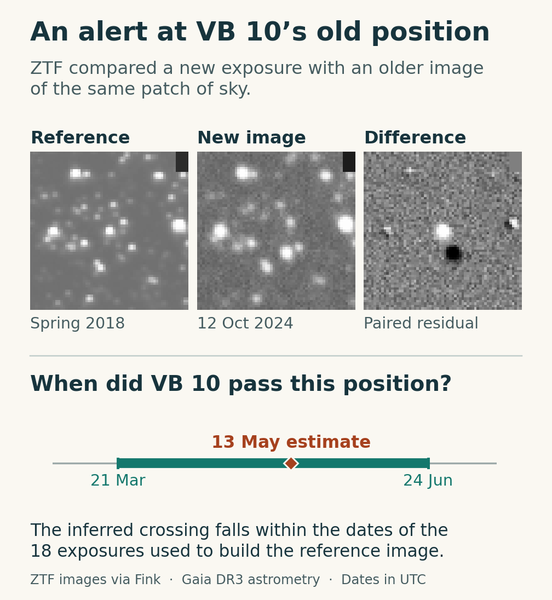

# Fink anomaly investigator

This is an experiment in iteratively building pipelines for open-world discovery with frontier language models. Agents propose explanations for unusual telescope alerts, check them against public measurements and catalogs, and record what ruled each explanation in or out. Each new search starts with a test on objects whose identities are already known.

## Using Fink as a discovery compass

We searched a full year of Fink's nightly anomaly archive and traced four sources from a sample of 132 ZTF IDs. At one dwarf nova, a repeatable **0.463″ positional shift** in subtraction images nearly vanished when measured directly on the same exposures. At FT Cam, two widely separated groups of positive alerts initially looked like recurrent outbursts. Direct photometry showed a four-magnitude eruption in 2025 and ordinary brightness in the 2019 group. The reusable compass gives each search a question, a comparison that can disprove it and a ranked backlog. Five rounds have now traced **16 sources** in the 2025 sample, leaving 53 eligible positions. An independent 2024 search reviewed three more and has ten eligible positions still open. [Discovery compass and next-packet commands](DISCOVERY_COMPASS.md) · [2025 findings](experiments/compass-2025/README.md) · [Independent 2024 search](experiments/compass-2024/README.md)

**A dwarf nova alternated between stronger and weaker eruptions for 80 days.** ZTF measured nine alternating peaks in MGAB-V960 in 2019. TESS independently localized the stronger eruptions, while other years failed the alternation test. The discovery chart already showed repeated peaks. At another dwarf nova, MGAB-V306, Pan-STARRS recorded a bright state in two filters in November 2013, six years before its dwarf-nova report. For the known supernova SN 2025xza, we measured red light four months after discovery and checked the explosion site in pre-event Hubble images. [Light curves, Hubble field and prior reports](experiments/compass-2025/batch-5/README.md)

**A dwarf nova brightened elevenfold six years before its dwarf-nova report.** Pan-STARRS caught MGAB-V488 on December 6 and 12, 2013. Its 2.60-mag rise in i was larger than the entire amplitude of a published half-day pulsation model. A second band and comparison stars on the original exposures support the rise. The same search found that the unclassified AT 2025iac reddened by about one magnitude near the center of a faint galaxy, with excess red light still present in June. [December eruption, host images and tests against classified transients](experiments/compass-2025/batch-4/README.md)

**How often does MGAB-V243 erupt?** Its 2019 discovery plot already showed repeated peaks. Five of six well-observed ZTF intervals between eruptions lasted 14–20 days. In all five years with enough independent ASAS-SN observations, the star returned closer to the same brightness after 14–20 days than after either shorter or longer intervals. The result held after correcting for nearby stars on the same images. At another dwarf nova, ASASSN-25ba, ZTF caught two bright dates 22 days apart, with the star more than three magnitudes fainter between them. [Light curves, prior observations and replay](experiments/compass-2025/batch-3/README.md)

**A helium binary was brighter 37–40 hours before its discovery exposure.** The January 19 points for J0722 already appeared in the discovery paper as difference magnitudes. Direct ZTF measurements and reference-corrected forced photometry show an excess in both bands. No earlier date among 267 comparable two-band visits was as bright in both. In April, a further brightening lay four weeks beyond the last observation in the paper’s figure. Hiroshi Itoh observed that episode on April 15, followed by ZTF on April 16. Its duration and the physical origin of the early light remain open. [Measurements, original sources and replay](experiments/compass-2025/batch-2/README.md)

## An 11.62-day eclipse candidate and a star that brightened across seasons

**ZTF18abjtfpx fades deeply every 11.62 days.** Earlier surveys had flagged the star, and ALeRCE had suggested an eclipsing binary with a roughly 5.8-day brightness cycle. Our red-band fit predicted which alternate cycles would go faint. On 88 green observing nights absent from both red series, the source was a median **1.56 magnitudes fainter** in the predicted deep window than halfway through the cycle. Two nearby comparison stars changed by less than 0.02 mag between those windows. On 41 dates the missing light was centered a median 0.10″ from Gaia DR3 4479632717757053440. Spectroscopy or sharper imaging during eclipse could establish which components are involved. [Phase plot, competing periods and offline replay](experiments/october-census/timing/README.md)

**ZTF18abqclig was about 2.35 times brighter in green in 2023–25 than in 2021–22**, relative to five nearby comparison stars. We found the red-band change while tracing a fresh November 2026 Fink alert, then fixed the comparison before retrieving the green measurements. ATLAS had previously flagged stochastic variability at the position. The red and green observations establish a later bright state over multiple observing seasons. [November search, field comparison and source archive](experiments/november-search/README.md)

## What survived an entire month of telescope alerts?

We traced all **130 distinct objects** in Fink’s October 2026 anomaly archive. The first screen admitted 20. Fourteen matched known variable stars in VSX, one matched a previously classified supernova, and five led to repeated detections near Gaia stars. A separate audit of failed broker lookups added a sixth position to investigate. All six showed brighter direct-image measurements on positive-residual dates. At ZTF17aacydyv the two ways of measuring brightness agree across 130 dates, and a separate infrared telescope also measured changes near that position. The star responsible and its physical class remain open. [Full-month results and graphic](experiments/october-census/README.md) · [All 130 object decisions](experiments/october-census/results/outcomes.csv) · [How we resolve disagreements](DISCREPANCIES.md)

## Why would a telescope keep flagging a star’s old position?

The Zwicky Transient Facility (ZTF) looks for changes by subtracting an older image from a new exposure. A stellar explosion can leave a bright spot in the difference. A familiar star drifting across the sky can leave *two* spots, one where it used to be and one where it moved. Telling those cases apart matters when astronomers decide which alerts deserve follow-up observations. [ZTF image processing](https://arxiv.org/abs/1902.01872) · [Fink follow-up observations](https://arxiv.org/abs/2603.29511)



For the October 12, 2024 alert ZTF18abgobyb, a search within three arcseconds of its position returned no SIMBAD catalog entry. We used the Gaia satellite’s measurement of the star VB 10’s motion to estimate **when it passed that position**. The answer was around May 13, 2018. The telescope’s own record provides an independent check. It dates the 18 exposures in its reference image to March 21 through June 24 that year. The same bright–dark pair appears on three observing dates in 2024. Those observations support motion as the explanation. An unrelated source along the same line of sight is still possible. Image intensities in the graphic are stretched separately for display. [Calculation and archived dates](results/moving-star/report.md) · [Three-date image comparison](review/inspection.md) · [Figure source](figures/vb10.py)

**What did earlier work establish?** Fink already ranks unusual ZTF alerts. Its team used observations from several telescopes to investigate rare events, including a supernova with earlier activity. They also documented alerts produced by high-proper-motion stars. This repository uses four of their published star identifications to test our interpretation before looking at other alerts. [Fink anomaly service](https://doc.ztf.fink-broker.org/services/search/anomaly_detection/) · [Pruzhinskaya and colleagues, sections 4 and 5](https://arxiv.org/html/2603.29511v1)

**What does this pilot add?** It makes a small investigation reproducible. The screen recovered all four known moving stars by their exact Gaia IDs and left three known supernovae unflagged. We applied it to 20 sampled objects from October 2024, including the VB 10 case above. In a second sample of 20 objects from October 2026, four reached catalog review. All four had entries in the AAVSO International Variable Star Index. The surviving count was zero in that sample. These two selected samples do not tell us how often the screen would miss a new source across the full survey. [2024 case table](results/report.md) · [Registered 2026 method](experiments/replication/protocol.md) · [2026 results](experiments/replication/2026-10/results/summary.md)

## Replay the pilot

Run from this directory on Linux or macOS with Python 3.10 or later. The replay uses the standard library and the checked-in archive responses.

```sh
make verify
python3 pilot.py replay --out results
python3 motion.py ZTF18abgobyb --out results/moving-star
python3 agents/review.py plan --limit 3
```

The first command runs tests, reproduces the generated analysis, report and review packet, and compares them with the saved outputs. The second command exposes the same pipeline directly. The third checks the reference exposure dates and the SIMBAD identity against their separately archived responses. The fourth shows which cases agents can investigate. [Agent roles, budgets and cache](agents/README.md)

## Calibration and sampling

1. Freeze the labels in `data/controls.json`. Four distinct physical stars come from Table 4 of Pruzhinskaya et al. G 260-1 appears under two ZTF identifiers in that table and contributes one control. SN 2023mtp, SN 2023ixf and SN 2023bee are negative controls for moving-star contamination. The classifier receives a sky position, observation time and Gaia measurements. It does not receive a star name, label or expected Gaia ID. The answer key compares the result to the published identification and its SIMBAD Gaia DR3 alias. [Fink follow-up study](https://arxiv.org/html/2603.29511v1) · [SN 2023ixf](https://www.wis-tns.org/object/2023ixf) · [SN 2023bee](https://www.wis-tns.org/object/2023bee) · [SIMBAD identifier lookup](https://simbad.cfa.harvard.edu/simbad/sim-tap/sync?REQUEST=doQuery&LANG=ADQL&FORMAT=csv&QUERY=SELECT%20ids.id%2Cgaia.id%20FROM%20ident%20AS%20ids%20JOIN%20ident%20AS%20gaia%20ON%20ids.oidref%3Dgaia.oidref%20WHERE%20ids.id%20IN%20(%27G%20260-1%27%2C%27G%20135-67%27%2C%27LP%20624-55%27%2C%27Wolf%20611%27)%20AND%20gaia.id%20LIKE%20%27Gaia%20DR3%20%25%27).
2. For each control use its most recent Fink detection before 2026-02-01 UTC. Query Gaia DR3 around the alert centroid within 60″. Require total proper motion of at least 150 mas/year and at least five times the quadrature sum of its two reported component errors. Propagate the Gaia reference position from its catalog epoch (J2016.0 here) to the alert observation time. Accept a position within 2.5″ of the intervening line segment. A star can leave a residual near its old or current position. The calculation uses the local tangent plane and catalog `pmra`, which includes cos δ. Parallax, perspective acceleration and positional covariance are omitted. The search cone also limits sensitivity to the fastest stars. [Gaia DR3 fields](https://gaia.aip.de/metadata/gaiadr3/gaia_source/).
3. Before examining the one-month sample, fix its UTC interval and budget. Keep the packet with the lowest Fink anomaly score per object in that interval, sort these packets by time and take 20 at evenly spaced indices. Lower scores are more anomalous. Time coverage follows available anomaly packets. The sample is purposive. Only history available through each selected packet enters its measurements. Current external catalog contents provide retrospective identification. [Fink anomaly API](https://doc.ztf.fink-broker.org/services/search/anomaly_detection/) · [Object histories](https://doc.ztf.fink-broker.org/services/search/objectid/).
4. Run the detector unchanged on the sampled targets. Exclude control IDs, their documented alias and matches to their recovered physical Gaia sources from independent exploration. A failed calibration closes the packet gate. All seven agreements are required for this pilot.
5. Apply the initial candidate filter. Triage checks include the foreground-star screen, per-packet CDS/TNS fields, a current SIMBAD cone of 3″, at least three quality-selected UTC dates, at least two dates with positive subtraction residuals, and anchor DRB ≥ 0.8. A history point requires DRB ≥ 0.8 and 0 < difference-magnitude uncertainty ≤ 0.2. Negative residuals can reflect a reference brighter than the science image. Missing TNS metadata is explicitly recorded. A failure of the broker's CDS service is recorded separately. [ZTF subtraction and filter fields](https://zwickytransientfacility.github.io/ztf-avro-alert/schema.html).
6. The first run exposed an important catalog gap. After independent review, a second-stage VSX query was added for **all** objects clearing the first filter. It archives each 5″ cone and checks the returned separations against its coordinates. One match within 1″ closes a new-source claim and makes the case eligible for an alias audit. Wider or multiple matches remain for inspection. Both the first-pass disposition and downstream catalog decision are preserved. Each packet has at most three cases. [AAVSO International Variable Star Index](https://vsx.aavso.org/) · [VSX catalog at VizieR](https://cdsarc.cds.unistra.fr/viz-bin/cat/B/vsx).

These seven literature cases test one contaminant screen. They are a retrospective positive/negative control check with known labels available to the developer. Sensitivity on a representative population, false discovery rate and readiness for astronomical confirmation remain unmeasured. A star track or near catalog neighbor suggests a counterpart. Registration, source confusion, reference subtraction and the quality of an underlying catalog classification can still affect the interpretation.

## Run another bounded window

For a fresh replication, register a discovery window and review budget before retrieving the new labels. This example tests the next disjoint calendar month.

```sh
python3 pilot.py fetch --start 2024-11-01 --stop 2024-12-01 --limit 20 --snapshot runs/2024-11
python3 pilot.py replay --snapshot runs/2024-11 --out runs/2024-11-results
python3 agents/review.py plan --packet runs/2024-11-results/review_packet.json
```

Fetch uses `curl`, sequential bounded HTTPS requests, per-request timeouts, limited retries, response-size caps and content checks. It supports 1–31 days and 1–20 objects. A partial first-stage download resumes when the same command is repeated. A completed primary snapshot is preserved. If the subsequent VSX download was interrupted, run `python3 pilot.py vsx --snapshot runs/2024-11`, then replay. Each raw response has its original request, UTC retrieval time and SHA-256 of the uncompressed bytes in its manifest. A frozen replay never silently refreshes a source. Historical alert selection and retrospective catalog snapshots can differ across refreshes. [Primary requests and checksums](data/pilot/manifest.json) · [VSX requests and checksums](data/pilot/vsx/manifest.json)

For the next moving-star case, compare the inferred crossing date with the coadd's earliest and latest exposure dates. Run `python3 motion.py OBJECT_ID --snapshot SNAPSHOT --out NEW_DIRECTORY --fetch` for the first capture and omit `--fetch` for offline replay. A control population of shifted sky coordinates and a second disjoint set of labeled stars would test chance alignments before scaling that screen. The number of closed false leads per expert review hour and the number of surviving cases with independent image evidence are the useful operating measures here.

This work uses public ZTF alert data served by Fink, ESA Gaia DR3 through NASA/IPAC IRSA, SIMBAD and VizieR at CDS, the AAVSO VSX and TNS. Individual rows retain their source identities. [Fink](https://fink-broker.org/) · [ZTF data access](https://irsa.ipac.caltech.edu/Missions/ztf.html) · [Gaia acknowledgements](https://www.cosmos.esa.int/web/gaia-users/credits) · [SIMBAD](https://simbad.cfa.harvard.edu/simbad/)

## Replication on October 2026

An independent astrometric check tested the closest call. Across 269 nights, the ZTF detections of ZTF18abdjpbo lay a median 0.134″ from the Gaia star after accounting for its motion. [Near-cutoff counterpart investigation](experiments/replication/2026-10/astrometry/README.md)

The next run used the last completed calendar month and a new set of 20 object IDs. The originally registered screen admitted four. All four had published VSX counterparts, so the sample yielded zero uncatalogued survivors. An exploratory check also found catalog counterparts for all five objects withheld after their historical broker crossmatches failed. [Registration](experiments/replication/protocol.md) · [Counts and object-level identifications](experiments/replication/2026-10/results/summary.md)

```sh
python3 coverage.py
python3 replication.py
make verify
```

These commands replay the checked-in archive on a clean checkout. The coverage script can retrieve missing source responses. The replication script reads the frozen cohort and its two additional VSX responses for historical service failures. The three alias-audit cases can be inspected with `python3 agents/review.py plan --limit 3 --packet experiments/replication/2026-10/results/review_packet.json`.
