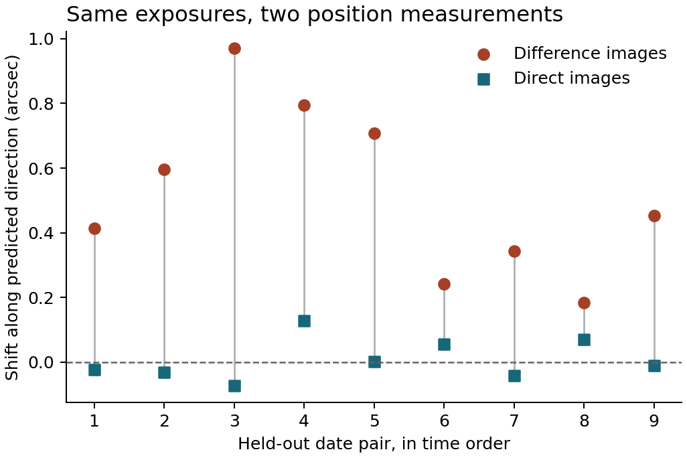

# What a year of Fink alerts taught us to check

The strongest discrepancy appeared at a known dwarf nova, SDSS J162520.29+120308.7. Across nine held-out date pairs, the bright residual shifted **0.463″** along the direction predicted by the earlier data. On the same exposures, positions measured directly on the science images shifted **−0.015″** along that direction. This object ranked 45th for recurrent brightenings and 52nd for fading. Looking at *where* the light changed brought it to the top of a different queue. [Discovery compass and commands](../../DISCOVERY_COMPASS.md) · [Source and catalog identities](identifications/README.md)

## Where did the position shift come from?

For each position we paired positive and negative residuals from the same filter within 30 days, using each UTC date at most once. The earliest two thirds of the pairs set the direction. For this dwarf nova the positive residual was south of the negative residual in all 26 red pairs. The green test fell below threshold. The only Gaia DR3 source in the 5″ cone, 4459922356886052992, moves in roughly the same direction, but by less than 0.002″ in 30 days. Motion between these paired observations is too small to account directly for the measured separation. A moving source subtracted against an older reference can still leave displaced residuals. [Pair selection and geometry controls](astrometry/README.md) · [Gaia, images and alternative explanations](astrometry/skeptic.md)

Seven of nine held-out pairs used different field/reference combinations. Matching within a single reference left too few independent pairs to repeat the original test. There was some separation by sign even within each field. The direct-image comparison matched the same exposure time, field, CCD and quadrant for **all nine** held-out pairs. It favors an astrometric shift amplified in the subtraction. The precise contribution of reference construction, seeing, color and unresolved blending remains open. A registered fit of the signed PSF to the original reference and science pixels could distinguish these explanations. [Reference-group counts and same-exposure vectors](astrometry/reference.json) · [Test definition](astrometry/reference-protocol.md) · [Figure source](figure.py)

## What the three brightness searches recovered

| Search | Object | What the data support |
|---|---|---|
| Recent onset | **SN 2025oq**, ZTF25aaccmjq | Six quality dates during its first 17 days. A Type Ic spectrum was already reported before Fink's February 3 anchor. A later spectrum refined the classification to broad-lined Type Ic. The DR24 direct-source cone was empty; the registry and galaxy-offset residual establish the recovery. |
| Separated bright detections | **FT Cam**, ZTF18abodmfy | In August 2025 its direct red median was 3.93 mag brighter than its outside-window median, and green was 4.31 mag brighter. In November 2019 those differences were −0.25 and −0.19 mag. The earlier positive residuals sampled an ordinary brightness level. |
| Repeated fading | **V1060 Cyg**, ZTF18aazenpc | Negative-residual dates had fainter direct medians by 0.624 mag in green (164 negative, 148 positive dates) and 0.546 mag in red (73 negative, 118 positive dates). The sign carries real brightness information in both bands. |

FT Cam's groups of positive red detections occurred in seven distinct years. Across the selected direct series through August 24, 2025, only **one** episode met the stricter two-night, two-magnitude brightening test; green caught it on both dates. Two additional red excursions had one bright night each. Cadence and selection limit the episode count. Independent AAVSO measurements caught FT Cam bright just before that final interval, on August 18 and 19. [Original alerts and registered windows](results/ledger.json) · [Direct measurements](results/direct.json) · [Observer dates, spectra and source receipts](identifications/README.md) · [SN 2025oq registry record](https://www.wis-tns.org/object/2025oq)

**A published clock tested on later observations.** An earlier Gaia study reported a **572 ± 25 day quasi-period** in V1060 Cyg's quiescent brightness, based on 59 measurements spanning about two cycles. We fitted that frequency to the faint side of ZTF's 30-day brightness distributions before 2023. On 14 later bins in 2024–25 per filter, the frozen sinusoid increased squared error over the training mean by **13% in green and 35% in red**. Neither nearby test period met the recovery criterion in both filters. The later data give little support to a persistent 572-day clock under this test. Quasi-periodicity, different bandpasses and imperfect sampling of quiescence remain plausible. [Published Gaia measurement, Table 5](https://academic.oup.com/view-large/415876112) · [Test fixed before fitting](behavior-protocol.md) · [Measured bins, episodes and sensitivity checks](results/behavior.json)

## Coverage and what remains open

The Fink endpoints returned 2,170 packets across twelve requests. **2,110** fell inside their own requested monthly UTC windows, covering **211 dates and 974 distinct ZTF IDs**. The stratified sample contained **132 IDs** with 131 verified histories. November's successful query returned zero anomalies. One July anchor had only later detections in both the batched and individual history responses, so its slot remained empty of usable evidence. [Monthly coverage, query receipts and missing history](snapshot/README.md)

Of the 131 verified histories, 18 failed the anchor-quality cut, 39 met no photometric pattern, and 74 met at least one. The eligible counts overlap: 5 recent onsets, 68 with separated bright groups, and 61 with repeated fading. Five eligible positions overlapped earlier work. The three primary case slots left 66 distinct eligible IDs in the backlog. The additional astrometric check could measure 45 IDs, of which two exceeded threshold. One was a prior project source and the other came out of that backlog. **65 distinct photometrically eligible, non-overlap IDs remain unreviewed from this run.** The table in the queue shows where to resume; the ledger preserves every rank. These positions have not been established as uncataloged sources. [Ranked queue](results/report.md) · [Full ledger](results/ledger.json) · [All centroid outcomes](astrometry/results.json)

The registration preceded archive retrieval. The extra astrometric search was registered after the three brightness routes returned a supernova and two dwarf novae. A known source can still expose a failure mode or constrain an untested behavior. All four reviewed sources had prior identities; the sample, thresholds and review budget do not measure the survey-wide discovery rate. The original foreground screen passed its seven controls. One proposed route control had no data in its evaluation period. The amended panel replaced only that missing coverage and retained the first panel's results. [Registration](protocol.md) · [Calibration and amendment](calibration/README.md) · [Direct-image protocol](followup-protocol.md) · [Science, reference and difference images](images/README.md)

Run `make verify-compass` from the repository root to rebuild the numerical evidence offline. The verifier checks the archive, gates, queues, catalog and image receipts, source-level measurements and alternate explanations. [Next-year runbook](../../DISCOVERY_COMPASS.md) · [Replay code](verify.py)
