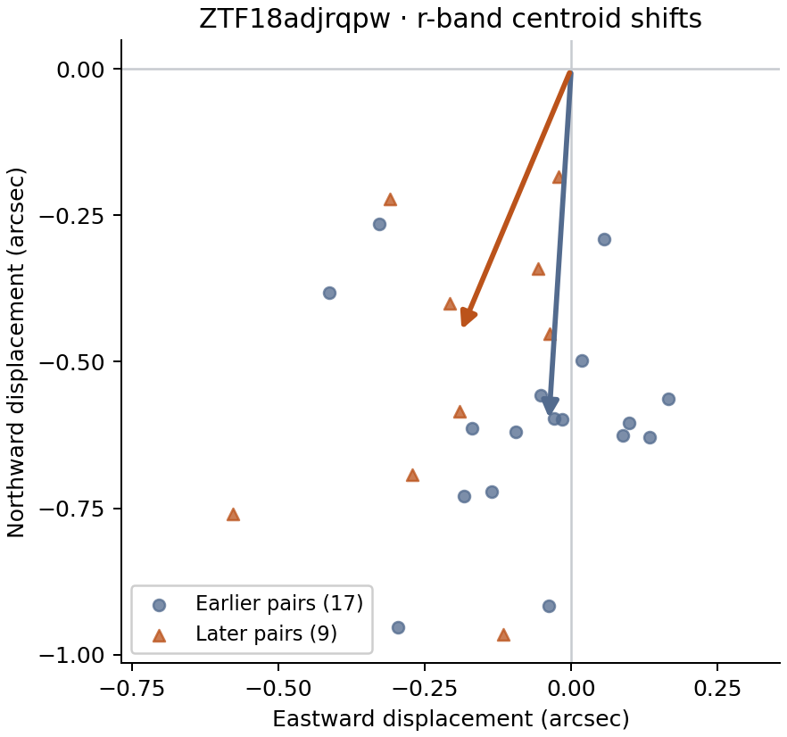

# Positive and negative residuals fall at different positions in ZTF18adjrqpw

Direct-image positions on the identical nine held-out date pairs have a projected shift of −0.015″. The difference images give +0.463″. Seven pairs span different reference groups, and neither group alone had sufficient matched dates for the validation test. These results favor a shift amplified by subtraction; the physical and instrumental contributions remain open. [Same-exposure plot and interpretation](../README.md#where-did-the-position-shift-come-from) · [Detector and direct-source measurements](reference.json)

Positive red-band detections were south of the paired negative detections in **all 26 date pairs**. The direction learned from the earliest 17 pairs predicted a displacement of **0.46″ along the same direction** in the final nine. The alert anchor was at ICRS 246.3345411°, +12.0524704° on September 30, 2025. This is a positional discrepancy that can help identify a moving star, distinguish blended sources, or reveal how the reference image was constructed. [Fink object](https://ztf.fink-portal.org/ZTF18adjrqpw) · [Dates, residual positions relative to each other, and candidate IDs](packet.json)



| Filter | Earlier / later pairs | Earlier east, north (arcsec) | Later east, north (arcsec) | Later projection | Change in direction |
|---|---:|---:|---:|---:|---:|
| Red | 17 / 9 | −0.038, −0.604 | −0.190, −0.452 | 0.463″ | 19.2° |
| Green | 9 / 5 | −0.279, −0.520 | +0.139, −0.341 | 0.235″ | 50.4° |

The red pair dates passed the registered distance and angle thresholds. Three earlier pairs contained opposite-sign detections on the same UTC date, each with distinct exposure candidate IDs. Their southward components ranged from 0.27″ to 0.95″. A date contributed to only one pair per filter and every later-set observation followed all training observations. The positive observation came 1–15 days after the negative in every later red pair, so time-dependent shifts and observing geometry deserve scrutiny. The green displacement missed both the minimum held-out projection and the directional threshold. [Frozen pairing rule and thresholds](protocol.md) · [All passband measurements](results.json)

**How often the test had enough observations.** Of 132 sampled IDs, 131 had a verified history through the anchor. Only 45 had the minimum paired-date coverage in at least one filter. Two of those 45 passed. The higher-ranked ZTF17aabshnt already belonged to the October 2024 pilot, where it was associated with the cataclysmic variable 1RXS J064725.3+491539. ZTF18adjrqpw occupied the single new review slot. The four synthetic geometry checks recovered the injected displacement, rejected pure shared drift and a reversing shift, and abstained on sparse sampling. They provide no empirical survey-wide false-positive calibration. A held-out threshold used to select from many objects is part of the search. Spectral or physical classification requires additional observations. [Earlier ZTF17aabshnt result](../../../results/report.md) · [Complete object ledger](results.json) · [Control outcomes](controls.json)

To apply the same test to a future calendar-year snapshot, first produce its primary ledger using the compass. Then run this command from the repository root, substituting the corresponding input paths and an output directory. The script checks that the anchor IDs and availability match the ledger. It writes the control, all-source and admitted-case JSON outputs.

```sh
python3 compass_astrometry.py --snapshot experiments/compass-2025/snapshot --ledger experiments/compass-2025/results/ledger.json --out experiments/compass-2025/astrometry
```

The reduction and replay use the Python standard library. Add `--verify` to check all three archived result files and the synthetic geometry controls offline. The snapshot loader validates the original Fink checksums and requests. To redraw this case's vectors, run `python3 experiments/compass-2025/astrometry/figure.py` with Matplotlib installed. [Reusable reduction](../../../compass_astrometry.py) · [Figure source](figure.py) · [Independent investigator assessment](investigator.md) · [Independent skeptical assessment](skeptic.md)
