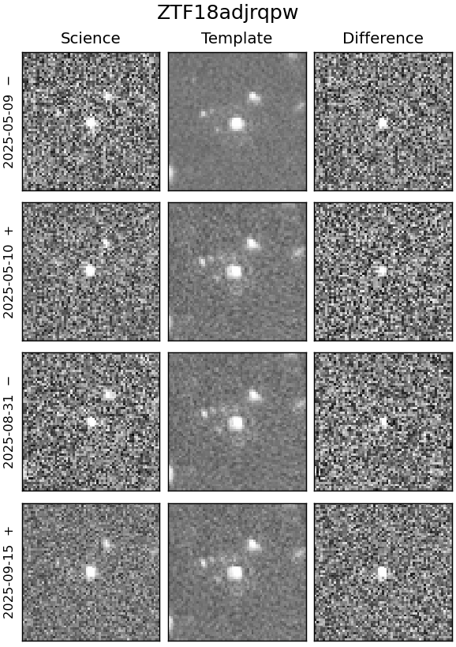

# Independent first reading of the centroid discrepancy

The [initial packet](packet.json) gives a positive-minus-negative red displacement pointing mostly south. Seventeen early pairs fix its direction. Nine later pairs retain a 0.463″ projection, within 19° of that direction. Green shows a weaker and less stable displacement. This evidence supports a sign-dependent astrometric effect at this alert position.

My leading alternative to two astrophysical emitters is a bright star whose motion, color, subtraction template or seeing systematically shifts the two residual centroids. The paired dates constrain slow temporal drift but permit sign-dependent subtraction errors. A resolved second star along the displacement, with positive alerts preferring one position and negatives the other, would strengthen a blend interpretation. A persistent bright–dark pair straddling a catalogued stellar track would instead favor a subtraction dipole. I will inspect the earliest and latest held-out red pairs, taking the lowest candid on each date when multiple alerts were retained, and propagate Gaia stars to all four individual epochs. This choice was made before retrieving these images or querying their catalogs.

## Source check

Gaia DR3 4459922356886052992 is the sole catalog entry within 5″ of the anchor at either J2016.0 or its propagated epoch. Of twelve Gaia entries within 60″, none met the pilot's moving-track criterion. The nearest star moves 9.281 mas/year west and 13.545 mas/year south, a direction within 11.6° of the held-out red sign displacement. Its position advances about 0.12″ between the two 2018 template windows and the 2025 measurements. Across the nine held-out pairs the median positive residual lies 0.175″ from the epoch-corrected Gaia position, and the median negative residual lies 0.312″ away. Their median positions bracket the catalog position, with positives on its southwest side and negatives on its northeast side. The Gaia precision quoted here describes the catalog motion. It does not measure the accuracy of each ZTF difference centroid. [Query and checksum](../images/ZTF18adjrqpw/gaia.json) · [Offsets for every held-out date](../images/offset-results.json)

The May 9–10 and August 31–September 15 images show a compact central difference residual on both signs. The source also appears on each reference. These independently stretched, pixel-sampled images do not resolve a 0.46″ split or show an unambiguous dipole. Slower stellar displacement between science and template epochs can change where a PSF subtraction leaves its two extrema, especially when flux changes. The expected shift in the Gaia photocenter alone is smaller than the offset being tested. [May 9](../images/ZTF18adjrqpw/3050378343515010019/gallery.md) · [May 10](../images/ZTF18adjrqpw/3051369184615015012/gallery.md) · [August 31](../images/ZTF18adjrqpw/3164192524615010016/gallery.md) · [September 15](../images/ZTF18adjrqpw/3179169874615015016/gallery.md)

**Disposition.** The selected object has a repeatable sign-dependent residual position. Seven of the nine held-out red pairs use different reference images; only two held-out pairs control that factor. One Gaia source, a direction close to its proper motion, and differing templates make a response of the subtraction pipeline plausible. The evidence leaves an unresolved companion or photocenter shift open. The discriminating observation would be registered, high-resolution direct images in bright and faint states, or an exposure-level PSF fit jointly accounting for motion and the two actual reference images. [Reference-field audit](reference.json) · [Offline image and position replay](../images/offset_case.py)
