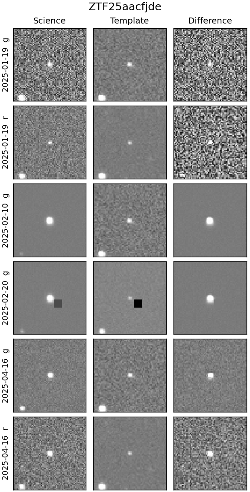

# Which star changed?

The earliest, middle and anchor exposures in the selected filter locate the residuals at all three positions. The recurrent source also has a fourth exposure with negative sign. We compared the Fink positions to Gaia DR3, propagated from J2016.0 using catalog proper motion where available. All three 60″ cones passed the original moving-star check. The images have separate display stretches. The archive magnitudes carry the brightness scale. [Independent first reading](../skeptic.md) · [Ten verified triplets and three Gaia cones](results.json)

**ZTF25aacfjde.** A faint point source already appears in the template. The stronger January 24 green exposure shows a single bright central peak in both the science and difference images. The four alert dates through January 31 have median positive-position separation 0.051″ from Gaia DR3 1087501559186713472. Nine Gaia entries fall within 60″ and only this star falls within 5″. [Original January sequence](ZTF25aacfjde/epochs/gallery.md)

After examining the full alert history, we checked the positions at the first faint measurement, the two bright February measurements and the April increase. On January 19 the science images show a faint central source and the positive residuals are compact amid substantial noise. On April 16 the central source and the positive residual are clear in both filters. The two bright February green exposures have central residuals within 0.059″ of the Gaia position. A square image defect off-center in the February 20 science and reference images is spatially distinct from the residual. The table gives measured offsets. Formal positional uncertainties were unavailable. The April resemblance between bands and reductions supports a common unresolved source at the Gaia position. The filters sampled different times on each date. [Exact exposures, signed offsets and magnitudes](rebrightenings.json)

| UTC date and band | Difference position to Gaia | Direct position to Gaia | Direct to difference position |
|---|---:|---:|---:|
| Jan 19 g | 0.163″ | 0.170″ | 0.126″ |
| Jan 19 r | 0.273″ | 0.127″ | 0.173″ |
| Apr 16 g | 0.055″ | 0.062″ | 0.018″ |
| Apr 16 r | 0.043″ | 0.096″ | 0.054″ |

The direct coordinates come from IRSA DR24 measurements with zero catalog flags. We matched the alert to the direct exposure by its time identifier, filter and timestamp within 60 seconds. Each selected exposure had a unique match. The nearest other cataloged Gaia source was farther than 33.3″ on all six exposures. These measurements constrain contributions by resolved neighbors. An unresolved source at the same position could contribute. [Gaia query and checksum](ZTF25aacfjde/gaia.json) · [Direct-source receipt](../direct/ZTF25aacfjde/photometry.json)

**ZTF18aagstwh.** The three red templates and science exposures each show two resolved stars near the center. The central negative residuals sit at the position of Gaia DR3 1403797832926731008. The positive and negative residuals have median nightly separations of 0.138″ (257 dates) and 0.192″ (366 dates) from that star. The next Gaia entry was 7.14″ from the anchor, consistent with the visible neighbor. This favors the central star as the source of the variability. A period or amplitude requires the light curve. [Three red exposures](ZTF18aagstwh/montage.png) · [Gaia archive](ZTF18aagstwh/gaia.json)

**ZTF18abmfrjj.** The template shows a close pair. The green difference images distinguish a compact positive residual in 2019, 2022 and 2025, and a weaker negative residual in 2024. Both signs localize much closer to Gaia DR3 4239802740358274688 (G = 13.04) than to the fainter 17.17-mag neighbor. At the anchor the respective separations are 0.024″ and 4.245″. Across 242 positive and 148 negative dates the nightly median offsets to the bright star are 0.074″ and 0.058″. Neighbor contamination of total light and detector nonlinearity at a bright peak remain possible. The thumbnails alone give no saturation diagnostic. [Four green exposures](ZTF18abmfrjj/montage.png) · [Gaia archive](ZTF18abmfrjj/gaia.json)

From this directory, run `python3 replay.py` and `python3 rebrightenings.py` to verify the archived evidence offline. Add `--plot` with Matplotlib installed to rebuild the figures. Each cutout manifest records the archive URL, candid, date and SHA-256 checksum. [Fink API](https://api.ztf.fink-portal.org/) · [Gaia archive at IRSA](https://irsa.ipac.caltech.edu/data/Gaia/)
