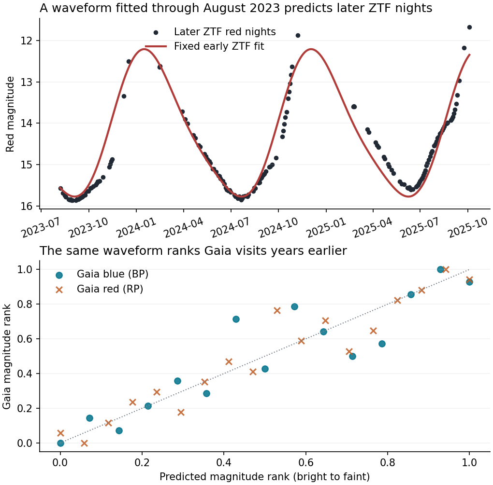

# Which clock predicts V1153 Aql?

A red light curve fitted in 2018–23 predicted both later ZTF observations and earlier observations from the Gaia spacecraft. The ZTF fit picked **321.78 days**. The 325-day period listed in the Variable Star Index also predicted both sets well. ATLAS had flagged irregular variability here, with automated estimates of 0.993990 and 443.379574 days. Predictions at both ATLAS estimates failed in both surveys. These measurements establish which catalog timescale is useful for this known Mira variable across 2014–25. [Catalog queries](../catalog/) · [VSX entry for V1153 Aql](https://www.aavso.org/vsx/index.php?view=detail.top&oid=2292)



The fit used 322 red nights ending August 4, 2023. Its period, phase, amplitude and shape were fixed before scoring later nights. For green, only a constant color offset was learned on the training dates. Each row in the table uses its own two-harmonic fit on the same red training set. The first two scores measure the reduction in squared prediction error relative to each band's training mean. The Gaia scores measure rank agreement after grouping observations into ten-day bins. The Gaia measurements span September 2014 through May 2017, before ZTF started collecting these data. [Registered test](protocol.md) · [All fitted periods and later ZTF scores](results.json) · [Gaia test and flag definitions](gaia-protocol.md) · [Gaia measurements and all scores](gaia-results.json)

| Period evaluated | ZTF red, 161 nights | ZTF green, 148 nights | Gaia BP, 15 bins | Gaia RP, 18 bins |
|---|---:|---:|---:|---:|
| 321.78 d, best early red fit | 92.1% | 82.7% | 0.911 | 0.957 |
| 325 d, VSX | 88.9% | 83.0% | 0.782 | 0.897 |
| 328.22 d, ASAS-SN | 69.6% | 75.7% | 0.232 | 0.511 |
| 0.993990 d, ATLAS | −97.0% | −36.8% | −0.057 | −0.082 |
| 443.379574 d, ATLAS alternate | −14.0% | −5.1% | 0.086 | 0.152 |
| 643.57 d, twice the fitted period | 88.5% | 76.8% | 0.921 | 0.977 |

The doubled-period model can reproduce a 322-day signal through its second harmonic. These data leave the exact fundamental period uncertain and do not establish a secular change. The originally registered daily aliases fit some later ZTF variation, but their Gaia correlations ranged from −0.04 to 0.38 in BP and RP. The exact ATLAS periods were compared after inspecting the originally registered results. Gaia's BP and RP have separate instrumental rejection flags. Their G-channel excess-scatter flag affected 45 of 47 transits and left zero bins under the strict G test. A second G calculation admitted transit averages with five or more contributing CCDs and no variability rejection. Its rank correlation was 0.947 across 20 bins, ranging from 0.939 to 0.965 after dropping one bin at a time. [Gaia epoch-photometry service](https://gaia.aip.de/metadata/gaiadr3/epoch_photometry/) · [Exact source receipt](sources/gaia.json)

On the 29 later green nights without a red measurement on the same date, the 321.78-day model gave rank correlation 0.865. That sample fell one night short of the 30-night threshold. No comparison stars in the 90″ field satisfied the original brightness-match rule in both bands. We then selected three comparison stars separately in each band and subtracted the median field-star deviation on each exposure. The corrected prediction retained all 161 red and 148 green nights. Error reductions were 92.1% and 82.7%. The controls test exposure-wide calibration. Their colors differ from this very red star. [Original selection](field-results.json) · [Comparison stars and corrected measurements](field-per-band.json)

## What the bright alerts traced

Before the October 6, 2025 anchor, red light was at least two magnitudes brighter than its usual 14.71 mag in nine groups separated by observed returns toward that level. Six groups had two bright red nights within ten days, and four of those had a green detection within two days at least two magnitudes brighter than its own usual level. The regular Mira cycle explains why widely separated positive detections recurred. The longest observing gaps were 116 days in red and 144 in green. In the two green intervals picked by the alert rule, the direct star was 1.21 and 4.04 mag brighter than its median outside those intervals. Red measured only one date per interval. [Every observed bright date and bracketing return](results.json) · [Route-level results](../results/direct.json)

## Does the star retrace the same colors?

At matched red magnitudes on opposite sides of a predicted brightness maximum, the 17 matched pairs had a pooled median fading-minus-brightening difference of −0.16 mag in green minus red. The five cycles had medians of +0.10, −0.17, +0.17, −0.39 and −0.22 mag in chronological order. Thus both later cycles were bluer on the fading side, while the three training cycles gave mixed directions. The pooled difference was −0.16 mag with independently selected comparison stars per band. Observing seasons limit the available phase coverage, with matched green measurements on 123 of 183 eligible fading dates and 78 of 134 brightening dates. The earlier cycles do not supply a consistent direction from which to predict the later ones. [Color-matching protocol and observational limits](color-protocol.md) · [Individual pairs and sensitivity checks](color.json)

Run the following from this directory with Python 3, NumPy and SciPy. The optional figure also uses Matplotlib. The numerical commands validate the archived source receipts before reconstructing the comparisons. The main batch direct-data replay is described in the parent report.

```sh
python3 check.py
python3 field.py
python3 field.py --per-band
python3 color.py
python3 gaia.py
python3 figure.py
```
