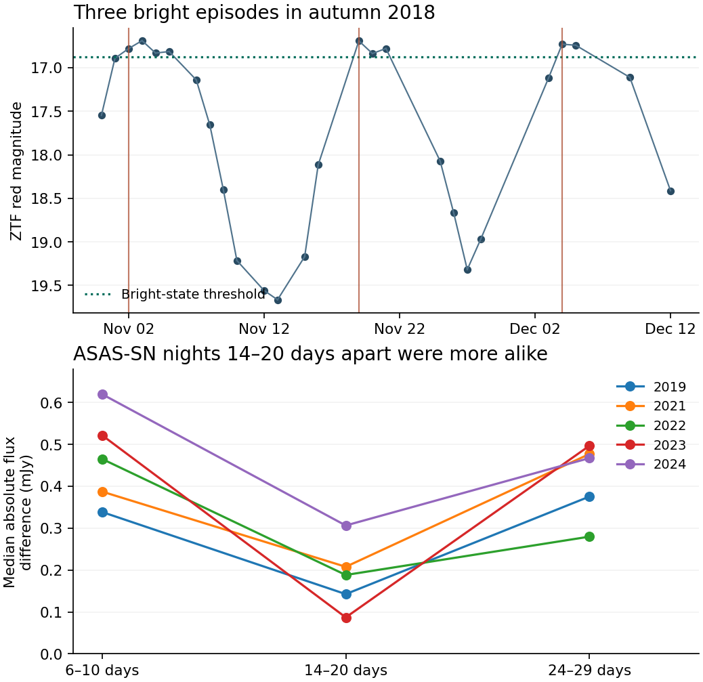
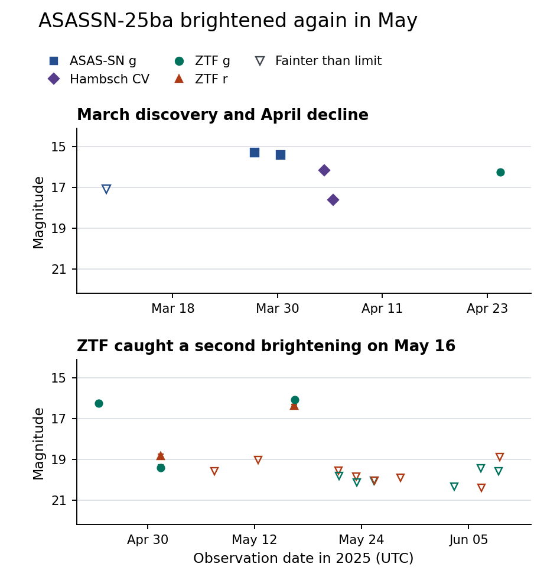

# A dwarf nova returns to a similar brightness after 14–20 days

MGAB-V243 regularly erupts. Its 2019 discovery plot already shows peaks roughly two to three weeks apart. We asked whether that spacing persisted in later seasons, where a clock fitted to the early observations failed to predict later eruptions. Five of six well-sampled ZTF gaps from one bright episode to the next were **14, 15, 15, 17 and 20 days**. The sixth lasted **44 days**. An independent telescope found the same characteristic spacing in each of five years with enough coverage. [Discovery plot by Gabriel Murawski](https://vsx.aavso.org/index.php?view=docs.open&fid=25415) · [ZTF bright groups and coverage](variables/eruptions.json)

We fixed three ranges of delays before examining the ordering of the remaining ASAS-SN nightly measurements. For each anchor night we asked how much the flux had changed roughly one, two and a half, or four weeks later. Each comparison started on the same nights and excluded the six intervals used to select the range, plus a separately studied 68-day episode. The **14–20 day** measurements were closer in flux than those at **6–10** and **24–29 days** in 2019 and 2021–24. In 2023 the median absolute changes were **0.087**, **0.521** and **0.496 mJy** for the middle, short and long ranges. The ordering survived subtraction of two nearby stars on the same images and correction for camera offsets and lunar phase. The matched dates overlap, so the five seasons measure repeatability without yielding a simple independent-pairs significance level. These data support a characteristic recurrence timescale. The phase and date of the next eruption remain uncertain. [Cross-survey results by year](variables/README.md) · [Registered test](variables/recurrence-protocol.md) · [All years and individual dates](variables/recurrence.json) · [Field and lunar controls](variables/controls.json)



**One apparent long eruption contained fades.** Across 2018–25 the red measurements resolved 30 bright groups, with green bright measurements in 26. A group lasting 68 days in 2020–21 looked unusually long. The red measurements stayed above the historical faint-quartile flux, but green fell back into its faint quartile on December 22 and January 7–8. The two filters covered 49 red and 48 green nights across the interval. Independent ASAS-SN flux tracked ZTF on 16 overlapping dates (Spearman 0.88). TESS saw variation in the vicinity, but its strongest image change landed 4.15 satellite pixels from the star. Its crowded aperture cannot establish the source of that change. [Magnitudes by night](variables/interval.json) · [ASAS-SN comparison](variables/asas-results.json) · [TESS localization](variables/tess-results.json)

The ASAS-SN catalog position also carried a historical quasar-candidate label. Its quoted redshift traced back to optical colors. The underlying catalog gives no spectroscopic redshift, and neither the SDSS DR17 nor DESI DR1 cone search returned a spectrum. The independent evidence is the ASAS-SN telescope's flux series. The original ZTF discovery and a Xingming Observatory outburst observation already identify MGAB-V243 as a dwarf nova. [Catalog lineage and observer records](catalog/README.md)

## A May brightening after the March discovery of ASASSN-25ba

ASAS-SN discovered this dwarf nova in March 2025 at approximately 15th magnitude. Franz-Josef Hambsch then measured a **1.447 mag** decline between April 4 and 5 while his check star changed by 0.006 mag relative to the same comparison star. By April 24 the source was bright again. It fell to g = 19.36 on May 1 and reached g = 16.15 on May 16. Our fixed-position measurements on the original ZTF green images give 16.24, 19.40 and 16.07 on the same dates. The bright states in March, April and May do not determine whether fresh eruptions or rebrightenings of one eruption produced the later peaks. [ASAS-SN discovery record](https://www.astronomy.ohio-state.edu/asassn/transients.html) · [Hambsch photometry, timing and sensitivity](catalog/README.md) · [Science, reference and difference images](images/README.md)



The direct red measurements bound the May event more tightly. From **r = 19.510 ± 0.083 on May 12** to **16.364 ± 0.013 on May 16**, the flux rose by a factor of **18** in 4.02 days. It then fell by a factor of **40** to **20.362 ± 0.156 on May 21**, 4.99 days later. A continuous interval brighter than r = 18 that included the May 16 measurement therefore lasted less than 9.01 days. The peak between visits could have been brighter. Forced photometry on the May 12 and May 16 exposures reproduces the rise. On May 21 the fixed-position red aperture was below its 5σ limit of 19.54 mag, consistent with the deeper catalog measurement. Both reductions use ZTF photons. We found no explicit May 16 account in the checked discovery and observer records. Sky Patrol returned no precomputed light curve within 6″ of the target. Other observations or accounts may exist. [Exposure-level light curve](results/timeline.json) · [Original aperture measurements](results/apertures.json) · [Observer coverage and earlier publications](catalog/README.md)

**Could we have seen another eruption?** We selected exposures from the public ZTF image inventory before measuring the target. During 2018–24 we selected one date per observed month. During 2026 we selected the deepest qualifying image on every observed date. The March 2025 discovery preceded the first qualifying ZTF image in our April–June window. Measuring every selected sky position, even when the catalog had no detection, gives the following sensitivity. [Selection and aperture protocol](onset-protocol.md) · [IRSA image interface](https://irsa.ipac.caltech.edu/docs/program_interface/ztf_api.html)

| Image selection | Selected exposures | Measured with a local limit of at least 18 mag | Target brighter than 18 mag |
|---|---:|---:|---|
| 2018–24, monthly comparison | 58 | 44 | 0 |
| April 1–June 15, 2025, one per band per night | 21 | 19 | 3 exposures on 2 nights |
| 2026, one per observed night | 61 | 38 | 0 |

Of 140 selected images, 28 could not be retrieved and 11 lacked sufficient usable target or comparison-star measurements. On 64 images, a fourth comparison star allowed an independent calibration check. All 64 checks recovered that star at five sigma and within 0.3 mag of its catalog magnitude. For a hypothetical seven-day plateau above 18 mag in both filters, the 2026 exposures could test **71%** of possible start times between the first and last usable visits, March 27–August 8. Across January 1–November 26, they could test **31%**. Seasonal gaps and shorter or fainter eruptions limit this search. The archive retains even the negative flux estimates. [All limits, fluxes, calibration residuals and duration tests](results/apertures.json) · [Original-image recovery and pixel-level comparison](fallback-validation/README.md)

An earlier apparent flare failed a field comparison. At the ZTF position Pan-STARRS resolves a faint star at g = 22.23. A 2012 y-band exposure placed it roughly three magnitudes above its stacked level. All ten comparison stars on that same exposure showed a large positive excess, and all eleven sky estimates were depressed by a similar amount. The field shares the purported flare. [Pan-STARRS measurements and field figure](images/ps1/README.md)

## A known Mira explains an apparent change of state

ZTF J192701.28+073352.1 appeared to jump **2.81 mag** in red between halves of a year. Fitting its early red data gave a **379.74 day** pulsation. The fit predicted later red and green nights, reducing squared prediction error by **87%** and **61%** relative to a constant. Removing the pulsation reduced the apparent step to **0.18 mag**. The published ZTF catalog adopted 385.10 days even though the individual filter fits were close to half that value. Gaia's independent long-period-variable solution was 380.7 ± 17.4 days. On 15 Gaia G time bins, the frozen ZTF fit had a rank correlation of 0.91, compared with −0.08 for a one-year model. The sparse Gaia color series and the green dates without red coverage give weaker tests. The star recovers a published near-year pulsation and illustrates how seasonal sampling can imitate a lasting change in brightness. [Period alternatives and state residuals](variables/results.json) · [Gaia predictions](variables/gaia-results.json) · [Original catalog and source identity](catalog/README.md)

## Reproduce the results and continue the search

This round took the next available source on each of the three brightness routes. All three had original rank three. The full 2025 sample contained 2,110 alerts from 974 distinct ZTF IDs, 132 sampled IDs, 131 with usable histories and 74 eligible sources. Prior-position exclusions and the successive review packets leave **59** distinct eligible sources to investigate. The next onset candidate is ZTF25aanlbls. ZTF17aabutiy leads both remaining variability routes, so the next review packet will choose a different third source. [Frozen ledger](results/ledger.json) · [Independent investigator](investigator.md) · [Independent skeptic](skeptic.md) · [Next-batch command](../../../DISCOVERY_COMPASS.md#resume-the-2025-queue)

From the repository root, the first command replays the queue, catalog identities, original image-triplet receipts, Pan-STARRS comparisons and broker measurements offline using the standard library. The second also reduces FITS images and the held-out multi-survey tests using NumPy, SciPy, Astropy, PyArrow and Requests. The last regenerates the figure using Matplotlib.

```sh
base=experiments/compass-2025/batch-3
python3 "$base/verify.py"
python3 "$base/verify.py" --science
python3 "$base/figure.py"
```
