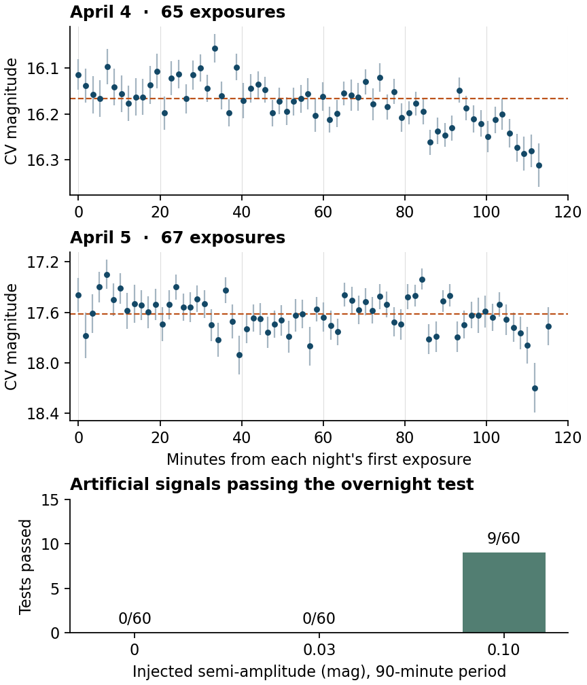

# Prior reports and independent measurements

## ASASSN-25ba had already erupted in March

ASAS-SN discovered a cataclysmic-variable candidate at this position before any alert in the ZTF25aaohzdc packet. Its survey log records a March 10.40 UT upper limit of g > 17.1, g = 15.3 on March 27.38 and g = 15.4 on March 30.38. The discovery entry gives March 28.36 and magnitude 14.9. The VSX entry was submitted April 3 under the dwarf-nova class UG, 0.16″ from the ZTF position. The survey matched a quiescent Pan-STARRS source near g = 22. Neither an orbital period nor a spectrum appears in these records. The SIMBAD 10″ cone and the BTS search box returned no sources. [ASAS-SN survey log](https://www.astronomy.ohio-state.edu/asassn/transients.html) · [Extracted discovery measurements](sources.json) · [VSX record and history](https://vsx.aavso.org/index.php?view=detail.top&oid=10848477) · [Catalog searches](results.json)

**An independently measured decline.** Franz-Josef Hambsch reported 170 exposures on April 4–6 in the AAVSO International Database. In the clear band with a V zero point, the median of 65 accepted April 4 exposures was 16.167 mag. On 67 accepted April 5 exposures it was 17.614 mag. The source faded **1.447 mag in one day**, while the instrumental difference between the same check and comparison stars changed by +0.006 mag. Each night's observations span roughly 1.9 hours. Filter differences matter when comparing these magnitudes to ZTF g and r. [AAVSO International Database request](onset.aid.json) · [Observation dates, controls and magnitudes](timing.json)



**Timing.** All 36 April 6 exposures exceeded the registered 0.2-mag uncertainty limit, so the three-night forecast had no usable final night. A separate test trained on April 4 and reserved April 5. The fit preferred the 6-hour edge of the search range. April 5 covered only 0.32 cycles, and the locked oscillation lowered prediction error by 1.5%. Frequencies one and two cycles per day away fitted the first night almost as well. Removing the nightly slopes increased the apparent training signal, while held-out improvement stayed below 9%. These measurements leave superhumps and the orbital period unresolved. Of 60 injected 90-minute waves per amplitude, just five at 0.10 mag and zero at 0.03 mag both passed the transfer test and returned a frequency within 0.3 cycles/day. That limited sensitivity prevents a useful physical amplitude bound. [Original test and coverage amendment](timing-protocol.md) · [Fits, field-star check and injections](timing.json)

**May coverage.** The ASAS-SN discovery row describes March. The named VSX reference also predates May. The official ASAS-SN Sky Patrol master list returned zero sources within 6″ of the Fink alert, so it supplied no precomputed light curve for this position. This search covers cataloged targets. The discovery team could separately measure positions in their survey images. [Sky Patrol cone receipt](sky-patrol.json) AAVSO returned only the April 4–6 series in March–June. VSOLJ's March–June observing inventory contained one April 25 record. The April 30 VSNET CV Circular lists it as a clear-band limit around 16.7 mag. In the five May VSNET export files searched, the eleven hits were copies of April circulars through May 11 that repeated the April observation. We found no account of the May 16 bright state in these sources. The mailing lists cover different dates and the search used three identifiers. Other observations, aliases and publications could establish earlier recognition of that episode. [Month and alias search receipts](coverage.json) · [VSNET April 30 circular](http://ooruri.kusastro.kyoto-u.ac.jp/mailarchive/vsnet-cvcirc/8929) · [AAVSO date counts](sources.json)

## Two earlier variable-star identifications

* **ZTF18aazutgw is the known Mira IRAS 19245+0727.** SIMBAD places it 0.186″ from the anchor. Chen et al. identify ZTF J192701.28+073352.1 at 0.10″. Their original table gives an adopted 385.1017206 days, with separate fits of 194.0059046 days in green and 188.3239431 days in red. They had 146 green and 162 red measurements. The VSX listing explicitly notes the shorter alternatives. Independently, Gaia's DR3 long-period-variable frequency gives 380.7 ± 17.4 days by first-order propagation. A new ZTF period close to 385 days would refine or recover an existing result. [Chen et al. and the catalog construction](https://arxiv.org/abs/2005.08662) · [Original Chen row](sources.json) · [Gaia frequency and cone matches](results.json) · [VSX notes](https://vsx.aavso.org/index.php?view=detail.top&oid=2207486)
* **ZTF17aabshbq is MGAB-V243.** Gabriel Murawski entered this dwarf nova in VSX in June 2019. Its VSX position is 0.09″ from the alert, and SIMBAD's star at the position is Gaia DR3 964727238971174400. Xingming Observatory recorded an outburst with two exposures on January 30, 2021 and explicitly identifies it as MGAB-V243, also AT 2021bke. Their images gave r-calibrated estimates 17.03 and 17.16 mag. An October 2024 VSNET activity report also includes the target and uses the more specific SS Cygni subtype. VSX gives the broader UG class and no period. The records establish prior outbursts while leaving room for new measurements of individual episodes. [VSX discovery entry](https://vsx.aavso.org/index.php?view=detail.top&oid=702876) · [Xingming Observatory report](https://xjltp.china-vo.org/xm47ht-2.html) · [VSNET October 2024 reports](http://ooruri.kusastro.kyoto-u.ac.jp/mailman3/hyperkitty/list/vsnet-outburst@ooruri.kusastro.kyoto-u.ac.jp/2024/10/?page=4)

### What was already visible in the MGAB-V243 discovery data?

Murawski uploaded a ZTF light curve on May 25, 2019. Reading its labeled time axis, bright measurements near JD − 2,400,000 of 58,335, 58,351, 58,365 and 58,386 already show intervals of roughly two to three weeks. These are approximate dates read from an image. The plot and VSX entry give no fitted recurrence interval. A later distribution of intervals can improve the measurement and test how well it persists over different seasons and telescopes. [Original discovery light curve](https://vsx.aavso.org/index.php?view=docs.open&fid=25415) · [VSX discovery history](https://vsx.aavso.org/index.php?view=detail.top&oid=702876)

The same coordinate also appeared as a **photometric quasar candidate**. Milliquas v6.3 row SDSS J063806.46+451457.0 lies 0.079″ from the alert. Both its classification and rounded redshift of 2.1 cite Richards et al. Their candidate row has an empty spectroscopic redshift, an optical photometric redshift of 2.125 and a reported interval of 1.970–2.230. Later Milliquas v7.2 and final v8 return zero entries within 10″. There are also zero SDSS DR17 primary spectra and zero DESI DR1 coadded fiber positions in that cone. These are bounded archive searches. A spectrum of this star would still materially improve the physical classification. [Cone results](recurrent-prior.json) · [Richards et al. 2015](https://doi.org/10.1088/0067-0049/219/2/39) · [Milliquas release history](https://www.quasars.org/milliquas.htm)

Sky Patrol's target ID 661427227898 lists both Milliquas and VSX, at coordinates identical to the v6.3 Milliquas entry to six decimal places. Those catalog labels determine which location Sky Patrol measures. Sky Patrol's forced light curve is generated from ASAS-SN survey exposures. It provides a separate telescope test of variability. The two target-list labels contribute a single ASAS-SN time series. Some historical VSNET reports reproduce ZTF or ASAS-SN measurements and need their original telescope identified before combining counts. [Sky Patrol receipt](../variables/sources/asas.json) · [ASAS-SN archive documentation](https://asas-sn.github.io/skypatrol/index.html)

## Replay

Run from this directory with Python 3.10 or newer.

```sh
python3 check.py | diff - results.json
python3 sources.py | diff - sources.json
python3 recurrent_prior.py | diff - recurrent-prior.json
python3 timing.py | diff - timing.json
```

With PyArrow installed, `python3 sources.py --verify-parquet` independently reads the archived Sky Patrol table and checks its schema and row count against the receipt. The catalog replay checks raw cone responses and the AAVSO and Chen queries against their checksums. VSOLJ asks for contact before using raw observer photometry for research. The receipt here records its dates and observer codes, together with the checksum of its full response. The separate VSNET receipts identify the public May mailbox exports and their decompressed checksums. Run `python3 coverage.py --verify-live` to repeat those coverage extractions and compare them to the saved inventory. The optional plot uses Matplotlib. [Source and observer archive queries](sources.py) · [Coverage extraction](coverage.py) · [Plot source](figure.py)
