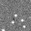
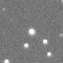
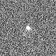
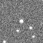
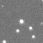
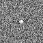
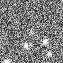
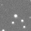
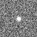

# ZTF stamps for ZTF17aabshbq

Earliest and middle usable prior dates in the alert band, plus the alert.

Dates are UTC. The archive stretches each PNG for display. Pixel brightness between panels is not calibrated.

| Date and candid | Science | Template | Difference |
|---|---|---|---|
| 2019-11-02 · 1035437750815010043 |  |  |  |
| 2022-10-13 · 2111474500815015006 |  |  |  |
| 2025-12-30 · 3285259000815010027 |  |  |  |
