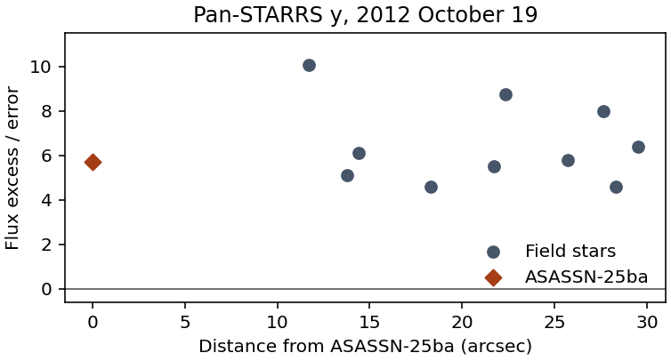

# A faint counterpart before the 2025 ASASSN-25ba outburst

Pan-STARRS DR2 object **96523098640728121** lies 0.14″ from ZTF25aaohzdc in the stacked images. Its stack magnitudes are g = 22.23, r = 21.74 and i = 21.95. The positional mean of the individual detections lies 0.11″ from the ZTF alert. The static PS1 source and compact ZTF residuals support an outburst at a pre-existing optical source. The 2025 peak green residual magnitude of 16.14 is about 6.1 mag brighter than the historic PS1 stack in g. Filter responses and subtraction versus direct measurement limit that comparison. [Stack catalog and request](sources/stack.json) · [Fink exposures](../ZTF25aaohzdc/epochs/gallery.md)

The catalog has 15 individual detections, with eight filter-night medians surviving the position, signal-to-noise and pixel-quality cuts. Three green, three red and two i-band dates were measured. None reached the registered same-filter threshold for a brightness change. Red spans 0.70 mag among its three usable dates. We also retrieved 51 single-exposure forced fits to the same object, including visits in which it was too faint to enter the individual source catalog. The quality cuts retain 42 exposures on 23 unique dates across 2010–2014, giving 27 filter-night combinations. On dates without significant flux, the median 5σ sensitivities were 21.94 in g and 21.72 in r. Cadence gaps leave earlier outbursts between visits unconstrained. [Selection](protocol.md) · [Detection and forced-photometry comparison](results.json) · [MAST forced-warp table](https://outerspace.stsci.edu/spaces/PANSTARRS/pages/298812409/PS1%2BForcedWarpMeasurement%2Btable%2Bfields)

**An apparent October 2012 detection.** The one y-band forced measurement with signal-to-noise above five gives 19.35 ± 0.16 mag on October 19, 2012. It has a poor fit to the stellar profile (reduced χ² = 3.75, compared with a median 1.09 on the other six y exposures). The survey masked it when computing the mean PSF, aperture and Kron fluxes. We tested the exposure against ten other sources chosen in advance by location and stack magnitude. [Single-epoch measurements](sources/96523098640728121-forced.json) · [Survey flag definitions](https://outerspace.stsci.edu/spaces/PANSTARRS/pages/298812465/PS1%2BDetection%2BFlags)

All ten comparison sources appeared brighter on that exposure by 4.57–10.07 times their respective flux errors. ASASSN-25ba's excess was 5.72 times its error. All eleven had estimated sky levels between −10.55 and −10.44 μJy per square arcsecond on that exposure. Their other-exposure medians ranged from +0.02 to +0.18 in the same units. All eleven received the mean-PSF mask. A field-wide photometric error explains the candidate excess. The usable historical measurements establish a faint counterpart and leave the date of any earlier outburst open. [All comparison stars and the target](field.json)

Run `python3 check.py` and `python3 field.py` in this directory to reproduce both checks using the archived responses. Add `--plot` to the field check with Matplotlib installed to regenerate the figure. The excess is the event flux minus that object's median flux on its other eligible y exposures. The divisor is the catalog error of the event exposure alone. [Archive requests and checksums](sources/) · [MAST catalog interface](https://catalogs.mast.stsci.edu/docs/panstarrs.html)
