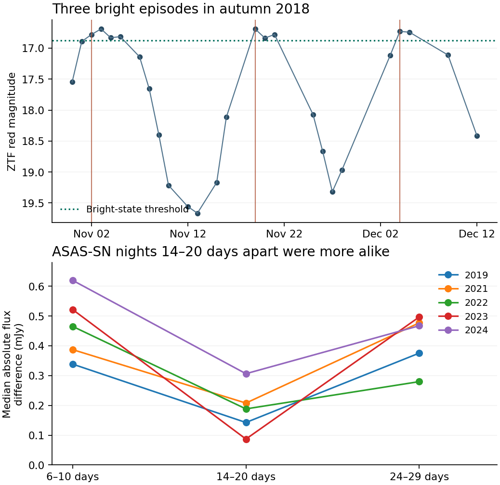

# A recurring two-to-three-week brightness pattern in MGAB-V243

**MGAB-V243 returned to similar brightness after 14–20 days across five well-sampled ASAS-SN seasons.** The dwarf nova was already known. Gabriel Murawski’s 2019 discovery plot shows several bright events separated by roughly this interval. The contribution here is a measurement across two telescopes and seven observing years, with comparison stars and an explicit test of how often the pattern repeats. A single clock fitted to early ZTF nights failed to predict later eruptions. [Original discovery light curve](https://vsx.aavso.org/index.php?view=docs.open&fid=25415) · [Prior identifications and dates](../catalog/README.md) · [Registered recurrence test](recurrence-protocol.md)



ZTF observed the source on 565 red and 479 green nights through September 30, 2025. A red group began when the star reached its early bright quartile (r ≤ 16.875 mag) and ended with an observation at its early faint quartile (r ≥ 18.588 mag). **30 of 43 groups** had two bright red dates within ten days. Green measurements near a bright date corroborated 26 of those groups. Six consecutive pairs of resolved groups had a return to faint brightness between them and red observing gaps no longer than five days. Their first bright dates were separated by **20, 17, 15, 14, 44 and 15 days** in chronological order. These are lower-cadence markers of the eruptions. They leave the actual time of onset uncertain. The known dwarf nova also had an independently observed January 30, 2021 outburst. [All dates, thresholds and gaps](eruptions.json) · [Xingming Observatory report](https://xjltp.china-vo.org/xm47ht-2.html)

## A check with a second telescope

ASAS-SN’s forced photometry measures flux even when a source is too faint for a reliable magnitude. We kept good observations, including negative fluxes, from 2019 through the anchor. We excluded all six ZTF intervals used to identify the timescale and the separate 68-day case below. For each remaining ASAS-SN anchor night we measured the absolute flux difference from later nights in three lag ranges. A night counted only if all three ranges had data in the same calendar year. The table gives medians of the per-anchor median differences, in millijanskys. A smaller value means that the star was closer to its earlier brightness. [Sky Patrol survey and data release](https://arxiv.org/abs/2304.03791) · [All matched anchors](recurrence.json)

| Year | Common anchor nights | 6–10 days | 14–20 days | 24–29 days |
|---|---:|---:|---:|---:|
| 2019 | 19 | 0.338 | **0.143** | 0.375 |
| 2020 | 1 | 0.183 | 0.382 | 0.235 |
| 2021 | 35 | 0.387 | **0.208** | 0.477 |
| 2022 | 59 | 0.465 | **0.188** | 0.280 |
| 2023 | 21 | 0.521 | **0.087** | 0.496 |
| 2024 | 14 | 0.619 | **0.306** | 0.467 |
| 2025 | 0 | — | — | — |

All five years with at least ten usable anchors favored 14–20 days over both comparison ranges. The result persisted in all five years after subtracting camera offsets and two lunar-month harmonics learned in the other years. Subtracting deviations measured from **two field stars on the same images** also retained the ordering in all five years. Applied to the comparison stars themselves, it appeared in zero of five and one of five years. A third preselected comparison star had no flux rows in the archive response. The tested windows cannot identify a unique recurrence period or a particular outburst mechanism. Adjacent anchors share observations and seasons differ in coverage. [Selection of control stars and year-by-year scores](controls.json) · [ASAS-SN acquisition requests](sources/asas.json)

## Why a red group lasted 68 days

Between November 10, 2020 and January 17, 2021, **19 bright red nights** belonged to one group because none of the 49 red nights crossed the faint-quartile boundary. Red still varied by 1.79 mag during those 68 days. Green crossed its own faint boundary on December 22 and January 7–8. On January 8, ASAS-SN measured 0.274 ± 0.032 mJy. Outside this interval the medians on ZTF bright- and faint-quartile dates were 0.901 and 0.218 mJy. On the 16 common green dates inside the interval the rank agreement between telescopes was 0.876. ASAS-SN’s 22 dates did not reach the outside-window faint median. Together these measurements show repeated dimming within the long red-selected group. A continuously bright outburst or standstill cannot be inferred from that grouping. The secondary ZTF field and AAVSO returned no dates in the interval. [Test fixed from red data](long-episode.md) · [ZTF and observer checks](interval.json) · [Individual ASAS-SN measurements](asas-results.json)

TESS offered another check in three sectors. In sector 20 the central aperture tracked brightness on ten red dates (rank correlation 0.891) and ten green dates (0.915). The brightest pixel in the red-selected difference image was 4.15 TESS pixels from the target, beyond the 1.5-pixel localization requirement. Sectors 60 and 73 overlapped only one and four red dates. The aperture correlation alone cannot assign the TESS light to the dwarf nova. A separate search for longer state changes selected a mid-2024 brightening of 1.39 mag in red. The earlier green window had two usable 30-day bins, short of the three required. [TESS pixel and aperture comparisons](tess-results.json) · [Long-term and clock tests](results.json)

## A seasonal alias in the known Mira IRAS 19245+0727

The other long-history source, ZTF18aazutgw, is a known Mira. Chen et al. adopted 385.1017 days and listed separate green and red estimates near half that value. Gaia DR3 independently listed a frequency corresponding to 380.7 ± 17.4 days. The early ZTF red fit picked 379.74 days. It reduced squared prediction error by 87.2% on 105 later red dates and 61.3% on 62 later green dates. A calendar-year model also predicted much of the later ZTF variation, with error reductions of 85.4% and 36.0%. A seasonal observing window makes these relatively close frequencies hard to separate with one ground-based survey. [Catalog records](../catalog/README.md) · [Held-out ZTF measurements and exact periods](results.json)

The fitted 379.74-day waveform also ranked earlier Gaia G measurements correctly. Its correlation was **0.907** across 15 ten-day bins (58 accepted transits), versus **−0.082** for the calendar-year fit and **0.650** for 385.10 days. The exact 188.32- and 194.01-day single-band catalog alternatives gave Gaia G correlations of 0.204 and −0.096, and reduced later ZTF red errors by only 15% and 17%. The published Gaia frequency reduced later ZTF red error by 85.5%. Gaia G was a specified secondary test. The primary blue and red photometers supplied seven and two bins, below the ten-bin requirement. Sky Patrol had no master-catalog counterpart within 6″. The raw red light curve appeared 2.81 mag brighter across a mid-2024 boundary selected in red. After subtracting the 379.74-day waveform the difference was 0.18 mag and its sign changed when individual bins were dropped. Pulsation explains most of that contrast. These data give no measurement of secular period change. [Earlier Gaia observations, flags and scores](gaia-results.json) · [Sky Patrol coverage](mira-survey.json) · [Registered Mira and TESS tests](followup-protocol.md)

## Reproduce the analysis

From this directory, run the commands below with Python 3, NumPy, SciPy, Astropy, PyArrow and requests. The optional figure requires Matplotlib. Pass `--out PATH` to any numerical script to write its result elsewhere. Archive acquisition options are documented in the scripts. Each TESS sector receipt includes its original request, raw FITS hash and the hashes of the reduced measurements. To repeat the six-hour pixel reduction, use the URLs in the receipts, or start a fresh source directory and use `tess.py --fetch`. [Selection before examining either source](protocol.md) · [Independent archive documentation](https://mast.stsci.edu/tesscut/)

```sh
python3 analyze.py
python3 eruptions.py
python3 interval.py
python3 asas.py
python3 recurrence.py
python3 controls.py
python3 tess.py
python3 gaia.py
python3 mira_survey.py
python3 figure.py
```
