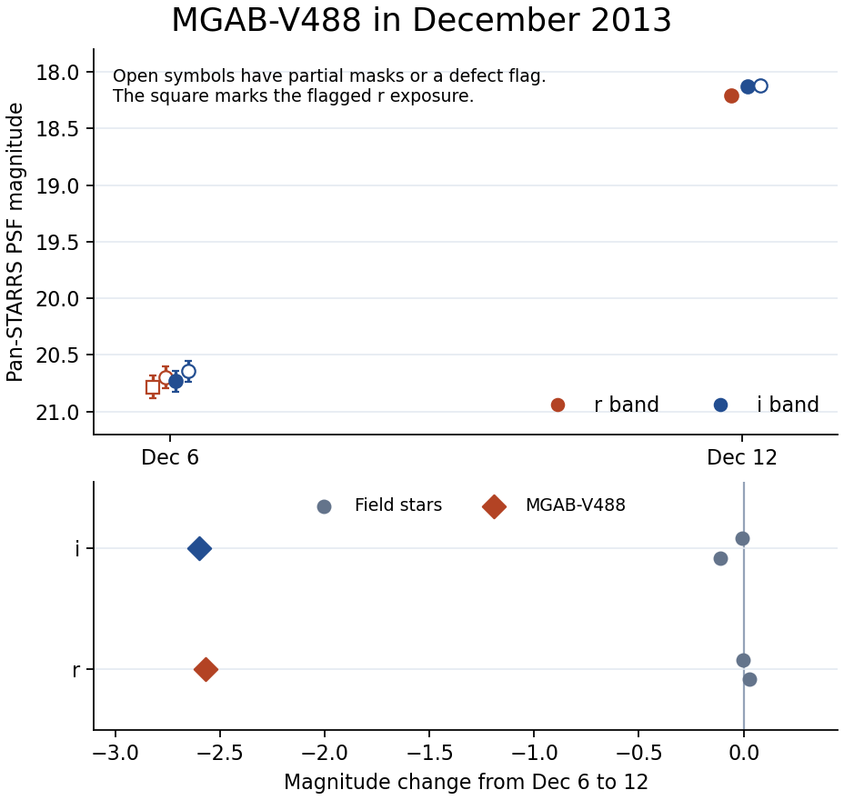
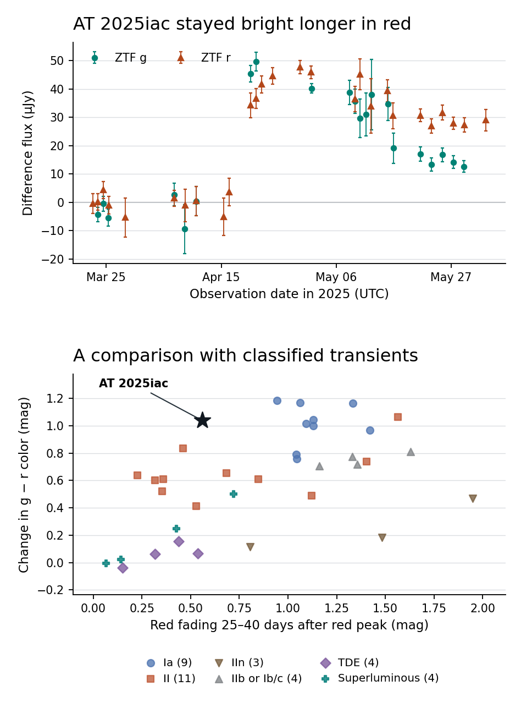

# A dwarf-nova eruption in 2013 and a transient at the center of a faint galaxy

**Pan-STARRS caught MGAB-V488 brightening about elevenfold in six days in December 2013.** In the i band it rose from 20.731 ± 0.094 on December 6 to 18.133 ± 0.012 on December 12, nearly six years before the September 2019 dwarf-nova report. Earlier work had fitted these survey-era observations with a 0.490445-day RR Lyrae pulsation. That fit permitted a total i-band swing of only 1.05 mag. The measured change was **2.60 ± 0.09 mag**. The original survey data were public. We found no explicit account of this dated two-band rise in the discovery chart or source papers we checked. [Historical observations and prior reports](catalog/README.md) · [Sesar et al.](https://arxiv.org/abs/1611.08596) · [Murawski's discovery page](https://sites.google.com/view/mgab-astronomy/mgab-v451-v500)



The red-band rise was about 2.5 mag. One faint r detection had a detector-defect flag. A second r exposure with no defect flag measured 20.697 ± 0.094, compared with 18.213 ± 0.015 on the bright date. Fixed-position fits on the same images reproduced the rise in both bands. Four same-image comparisons, two per filter, changed by at most 0.12 mag. Separate catalog reductions of the same exposure received one vote. [Source positions, flags and comparison stars](catalog/field.json)

We also tested the published pulsation directly on 598 ZTF filter-nights. After allowing the phase to move and subtracting local brightness levels, the strongest fitted template had only 26% of the published amplitude. The 95th percentile after resampling time blocks was 49%. Injected full-strength templates were recovered at every tested phase. The historical event and the independent telescope measurements challenge a persistent, dominant half-day pulsation; a weaker signal could remain. [Waveform, injections and observing cadence](variables/README.md) · [Exact template transfer](variables/template.json)

## What lit up at the position of AT 2025iac?

ZTF discovered AT 2025iac on April 20, 2025 at g = 19.7488. Our short-history route selected it on April 22. Its Transient Name Server record still had no physical type or redshift in the November 26, 2026 snapshot. The transient lies **0.133″ from the center of a faint extended galaxy** with a fitted half-light radius of 0.522 ± 0.049″. In both r and z, the galaxy was more extended than all 22 matched-flux stellar controls. The offset is comparable to the scatter in nightly transient positions, leaving its precise location within the central region unresolved. [Original discovery record](https://www.wis-tns.org/object/2025iac) · [Pre-event imaging and stellar controls](images/host/README.md)

**The green light faded faster than the red.** Positive and negative forced fluxes were consistent with zero before the event. Green and red reached 47 and 38 µJy during April 19–23. In late May those averages were 15 and 29 µJy. Red remained nominally above half its measured peak on dates spanning 43 days. The span was 35 days when requiring each above-threshold point to clear that level by two formal errors. Green crossed below its nominal half level between May 15 and 16. The g−r color went from a median **−0.31 to +0.73 mag** in same-night pairs near the start and a month later. One ZTF field alone gave a 0.83-mag color change. Dates between visits leave the true peak and exact crossing times uncertain. [Signed flux, uncertainties and half-peak brackets](results/onset.json) · [Definitions of ALeRCE forced photometry](https://alerce.readthedocs.io/en/latest/models/forced_photometry.html)



**Two ZTF detectors independently recovered excess red light in June.** Fixed-position apertures on original images include the host on both the pre-event and transient dates. The table subtracts the 2023–24 mean from each later mean; uncertainties include per-night noise and temporal scatter. Both June measurements passed the registered five-standard-error criterion after matching seeing. The held-out star changed by +0.023 mag in field 680 and −0.009 mag in field 633 in June. The two fields contribute separate exposures from one telescope. The July excess fell short of the criterion. August and September leave room for fainter residual light.

| Window | Field 680 excess in µJy (dates) | Field 633 excess in µJy (dates) |
|---|---:|---:|
| April 20–May 2 | 44.1 ± 4.6 (5) | 46.5 ± 3.6 (5) |
| June | 21.8 ± 3.2 (8) | 26.9 ± 4.3 (6) |
| July | 17.6 ± 4.0 (5) | Insufficient (0) |
| August | Insufficient (2) | 5.2 ± 4.2 (5) |
| September | 2.6 ± 5.6 (4) | 4.2 ± 5.3 (5) |

We measured 49 of 56 selected primary images and 38 of 57 on the second detector. Each supplied only one usable 2026 image; the planned later-baseline test needed four. A single cutout with insufficient depth or an unavailable image cannot place a useful bound on the source. [Image selection and coverage amendments](late-protocol.md) · [Primary field and blank apertures](results/late.json) · [Second detector](results/late-other.json)

**What class does the light curve resemble?** Of 62 preselected bright comparison supernovae, two failed a registry date check and 27 had enough color and red measurements in both windows. The closest source in the two measured quantities was **SN 2024faq**, a spectroscopically classified Type II at z = 0.026. It was also closest among the 14 controls with measurements matched to the target's actual observing dates. Removing known labels one at a time recovered 8 of 11 Type II and 8 of 9 Type Ia controls from their nearest neighbor, but did poorly on several rarer types. Of 2,000 perturbations of the target fluxes, 1,396 retained enough dates for both measurements. A Type II was closest in 1,281 of those trials. Those counts describe sensitivity to noise and peak-date assignment. They are conditional on a bright comparison sample and do not give class probabilities. [Control panel, exclusions, dates and confusion counts](results/comparison.json) · [Perturbations](results/sensitivity.json) · [SN 2024faq classification spectrum](https://www.wis-tns.org/object/2024faq/classification-cert)

The galaxy distance leaves an important competing interpretation. Its photometric redshift is 0.534, with a catalog 68% interval of 0.440–0.623. Its z-band magnitude of 22.18 falls in a range where systematic redshift errors grow. If the galaxy is the host at z = 0.534, apparent r minus distance modulus would be **−22.73 mag**; at z = 0.1 it would be **−18.61 mag**. These quantities omit extinction and K corrections, and observed r samples different rest-frame wavelengths at those redshifts. In a second comparison panel only four higher-redshift supernovae had both measurements. Four events from a separate published catalog of 30 stellar tidal disruptions had sufficient coverage; their color changes ranged from −0.04 to +0.15 mag. The measured reddening and confirmed extended host narrow the possibilities. A host spectrum would distinguish markedly different luminosity regimes, while an event spectrum would address the physical class. [Host redshift and spectrum searches](images/host/README.md) · [Conditional distance scales](results/sensitivity.json) · [Comparison design and limitations](comparison-protocol.md)

## What happened to the apparent dimming of ZTF17aabutiy?

A catalog-only search suggested a large change in this known dwarf nova in early 2021. We measured the same aperture on **all 174 field-selected ZTF images**, including 41 on which the target was missing from the source catalog. Among cataloged visits the aperture data alone implied a 0.97 mag red and 1.98 mag green decrease. Restoring the omitted nights reduced those contrasts to **0.18 and 0.52 mag**. The fraction of visits caught bright changed from 23.6% to 22.2% in red and from 20.0% to 18.2% in green. An ASAS-SN drop survived nearby-star correction, while the individual camera with adequate coverage showed a small change in the opposite direction. The evidence leaves a physical change of state unconfirmed. [All field visits, light curves and camera controls](variables/README.md) · [Original 336-day outburst report](https://arxiv.org/abs/2002.08447)

## Reproduce this round

The frozen year contains 2,110 anomaly alerts from 974 ZTF identifiers. We sampled 132, retrieved usable histories for 131, and found 74 eligible for at least one route. With prior reviews and calibration objects included, the fourth-round ledger flags 15 sampled positions as overlaps. This round took original rank four for recent onset and recurrence, and rank six for fading. **56 unique eligible sources remain.** Across the four rounds, the compass has investigated thirteen distinct sources. [Frozen queue](results/report.md) · [Independent initial readings](investigator.md) · [Skeptical review](skeptic.md) · [Command to resume](../../../DISCOVERY_COMPASS.md#resume-the-2025-queue)

Run from the repository root. The standard-library replay covers the queue, direct-source records, image-triplet receipts, forced photometry and comparison panels. The full replay also uses NumPy, SciPy, Astropy, PyArrow and Requests. The optional figure uses Matplotlib. All three commands read the archived inputs.

```sh
base=experiments/compass-2025/batch-4
python3 "$base/verify.py"
python3 "$base/verify.py" --science
python3 "$base/figure.py"
```
