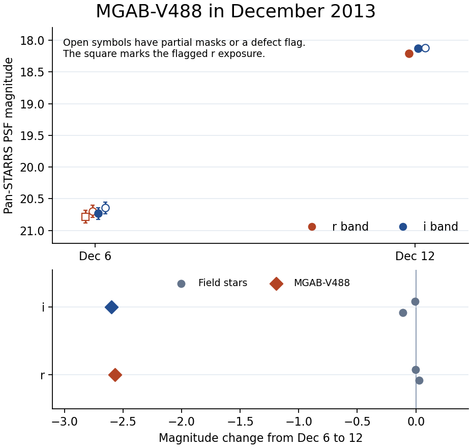

# What had already been reported?

## AT 2025iac was reported to the IAU registry by ZTF

The first green point in the frozen ZTF25aanlbls packet is the discovery observation. Jesper Sollerman, Christoffer Fremling, Daniel Perley and Theophile du Laz reported **g = 19.7488 at 08:42:59.996 UTC on April 20, 2025** on behalf of ZTF. The Transient Name Server received their report on April 22 at 10:12:02 UTC. It records the alert's exact ZTF identifier and a position 0.22″ from the anchor. In the November 26, 2026 registry snapshot its classification, redshift and classification-report bibliography are blank. The Caltech Bright Transient Survey returned no entry in the surrounding 0.02° × 0.02° box. The registry establishes discovery priority and leaves the physical cause open. [TNS object](https://www.wis-tns.org/object/2025iac) · [ZTF discovery report](https://ui.adsabs.harvard.edu/abs/2025TNSTR1494....1S/abstract) · [Exact registry row and survey results](priors.json) · [BTS query](bts.csv.json)

## MGAB-V488 has two published interpretations

ZTF18aaadshm is 0.19″ from the VSX position of MGAB-V488. In 2017, Sesar and colleagues fitted a Pan-STARRS RR Lyrae template to a source 0.22″ from this alert. Their row gives **0.4904450424 days**, peak-to-peak amplitudes of 1.39 mag in g and 1.20 in r, and classifier scores of 0.30 for RRab and 0.01 for RRc. These are parameters from fitting a family of pulsation templates to sparsely sampled data. The predicted period and amplitudes can be challenged directly in the longer ZTF light curve. [Sesar et al.](https://arxiv.org/abs/1611.08596) · [Source-specific fit](MGAB-V488-literature.xml.json) · [Cross-survey timing test](../variables/pulsation-protocol.md)

In September 2019 the VSX submission identified the source as a dwarf nova. Gabriel Murawski's discovery page gives **r = 18.4–21.4** and the class UG. The VSX entry credits both B. Sesar et al. and G. Murawski. Its period and outburst-interval fields are blank. In November 2022, a VSNET circular used the SS Cygni subtype and reported 20.5 mag on the 15th and 18.3 on the 19th. The circular attributes those magnitudes to ZTF alert photometry converted to direct magnitudes, so they document earlier recognition from the same telescope. [Murawski's discovery page](https://sites.google.com/view/mgab-astronomy/mgab-v451-v500) · [VSX submission and history](https://vsx.aavso.org/index.php?view=detail.top&oid=1498636) · [VSNET November 2022 circular](http://ooruri.kusastro.kyoto-u.ac.jp/mailarchive/vsnet-cvcirc/7258)

### A six-day brightening in the historical Pan-STARRS observations

A single PS1 mean source lies within 5″, at 0.138″ from the ZTF alert. Its 57 detections span August 2010–December 2014. On **December 6–12, 2013**, the source brightened from **i = 20.731 ± 0.094 to 18.133 ± 0.012**, a change of **2.599 ± 0.094 mag**. The corresponding r exposures give **20.782 ± 0.102 to 18.213 ± 0.015**. Each of the seven available r/i detections on those two dates is within 0.27″ of the ZTF anchor. The two dates sample a faint and a bright state six days apart. They leave the time of peak brightness and the length of the episode open. [Detection photometry and individual exposure checks](field.json) · [MAST detection archive](https://catalogs.mast.stsci.edu/panstarrs/detections.html?objID=166630444239155450)



**Image checks.** The selected faint r detection has a pipeline defect flag and lacks a usable aperture flux. A second r exposure 17 minutes later, with no such flag and 80.5% of the PSF unmasked, gives **20.697 ± 0.094**, still 2.48 mag fainter than December 12. In i, the faint selected point was downweighted for the catalog mean. Its December 6 repeat gives 20.645 ± 0.091. The two December 12 i detections agree within 0.009 mag despite different masked fractions. The selected i PSF major axes were 1.41″ and 1.09″ on the two nights, and the r values were 1.98″ and 1.43″. Aperture photometry in i independently of the PSF fit to the same pixels gives 21.05 and 18.15. Two comparison stars in each band pass the same cuts on the exact same image IDs. Their median changes were +0.012 mag in r and −0.059 in i. In the archive's fixed-position fits on the same exposures, the cleaner December 6 i warp gives 20.75–20.76 and the December 12 i warp 18.10–18.11. In r, the corresponding values are 20.83–20.86 and 18.22. Those ranges reflect duplicate reductions in overlapping skycells, which reuse the original exposures. [Exact image IDs, signals, image flags, field controls and forced photometry](field.json) · [PS1 definitions of the defect and catalog-mean flags](https://outerspace.stsci.edu/spaces/PANSTARRS/pages/298812465/PS1%2BDetection%2BFlags)

**The old model partly tracks the phases and misses the size of the changes.** The published period, phase and four empirical templates reduce the per-filter, per-date scatter from 0.977 to 0.797 mag over 23 filter-dates on 19 distinct nights. Only two of 100 trial phase shifts do as well as the published one. These are survey epochs available to the original search, so this is an in-sample phase comparison. Even with the stricter quality cut the scatter is 0.676 mag, and the i brightening exceeds the maximum swing the published template permits by 1.55 mag. The field and exposure checks support variability larger than the old pulsation fit allowed during the original survey itself. They leave open any weaker oscillation superposed on that variability. [Registered test](ps1-protocol.md) · [Period, phase-shift and chronological comparisons](ps1.json) · [Four archival template curves](ps1-templates.json)

**Priority of the December measurement.** Sesar et al. used survey-era Pan-STARRS observations and published the template solution. Their source table gives no individual event dates. The chart on Murawski's discovery page explicitly plots ZTF g and r over HJD − 2,400,000 = 58,150–59,050. Both December 2013 dates fall outside that window. The sources checked establish earlier recognition of the variable and dwarf nova. We found no explicit measurement of this two-filter six-day change there. The individual Pan-STARRS measurements were publicly archived before this analysis. [Sesar source table](MGAB-V488-literature.xml.json) · [Murawski discovery page](https://sites.google.com/view/mgab-astronomy/mgab-v451-v500) · [Checksum and axes of the inspected chart](discovery-chart.json)

## ZTF17aabutiy was observed in three earlier outbursts

Szkody and colleagues selected this source as a strong cataclysmic-variable candidate in the first year of ZTF. Row 193 of their second table gives **three outbursts over a 336-day baseline** and a magnitude range of 17.4–19.8. Their spectroscopy column is empty. The paper gives the number of observed eruptions without individual dates or a recurrence interval in that row. VSX added the star in March 2020. A July 2021 revision gave the dwarf-nova class, the broader range **g = 16.9–21.0**, and the ZTF alias **ZTF17aabvfoy**. These identifiers refer to one physical source. The November 2022 VSNET circular labels the star SS Cygni type and reports 19.9, 17.8 and 20.0 mag on November 13, 15 and 19 from ZTF alerts. [Szkody et al.](https://arxiv.org/abs/2002.08447) · [Original table query](ZTF17aabutiy-literature.xml.json) · [VSX revision and aliases](https://vsx.aavso.org/index.php?view=detail.top&oid=1542955) · [VSNET circular](http://ooruri.kusastro.kyoto-u.ac.jp/mailarchive/vsnet-cvcirc/7258)

For both dwarf novae, 5″ cones in the original Catalina dwarf-nova outburst catalog returned no published recurrence estimate. AAVSO International Database requests for the canonical names returned zero measurements between January 1, 2018 and January 1, 2026. For all three targets, the SDSS DR17 primary-spectra and DESI DR1 coadded-fiber tables returned zero rows within 10″. Spectra in other surveys or privately obtained observations could change the classifications. [Catalina catalog and measurement definitions](https://doi.org/10.1093/mnras/stv2921) · [AAVSO, Catalina, SDSS and DESI query results](priors.json)

The comparison supernova **SN 2024faq** has an original Type II classification spectrum. Charlotte Angus (SCAT) obtained it with SNIFS on the University of Hawaii 88-inch telescope on April 6, 2024. SNID matched Type II templates near maximum light, and the host emission lines gave z = 0.026. TNS lists classification report 16826 and spectrum 16913. This confirms the label for that comparison object. [TNS classification certificate](https://www.wis-tns.org/object/2024faq/classification-cert) · [TNS list of spectra](https://www.wis-tns.org/object/2024faq) · [Later Hubble and optical spectroscopy](https://arxiv.org/abs/2611.21742)

## Replay

Run from this directory with Python 3.10 or newer.

```sh
python3 check.py | diff - results.json
python3 priors.py | diff - priors.json
```

The first command checks the SIMBAD and variable-catalog cones and the BTS registry box. The second checks the compressed source records against the URLs and SHA-256 values in their JSON receipts. For the large daily TNS snapshot and the two public notices, the receipts record a hash of the entire downloaded file and a separate hash of the archived excerpt. Each program accepts `--fetch` to retrieve missing records. [Catalog cone code](check.py) · [Priority and spectroscopy code](priors.py) · [TNS download documentation](https://www.wis-tns.org/content/tns-getting-started)

The PS1 replay requires NumPy and Astropy. Use `python3 ps1.py | diff - ps1.json` and `python3 field.py | diff - field.json`. The MAST receipts retain the raw source and comparison-star rows. `python3 figure.py` regenerates the plot with Matplotlib. `python3 priors.py --verify-chart` fetches the image currently embedded in the named source section of the discoverer's page and checks its hash. [Historical timing code](ps1.py) · [Exposure and field checks](field.py) · [Plot source](figure.py)
