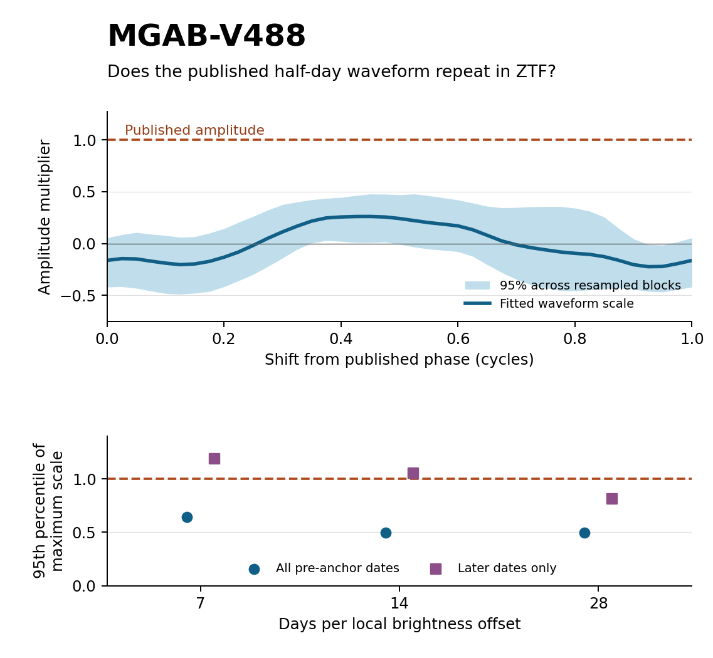
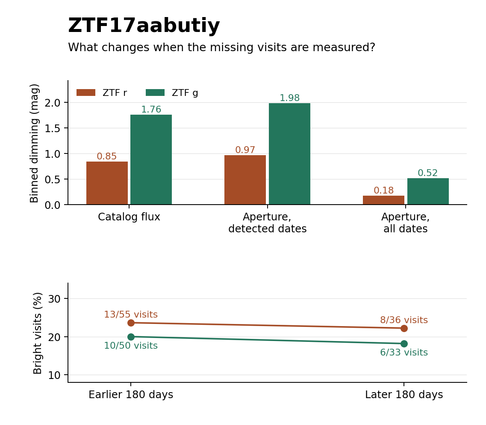

# Two known dwarf novae in the fourth compass queue

## MGAB-V488 challenges an older pulsation model

An independent telescope can test a specific historical interpretation of **ZTF18aaadshm (MGAB-V488)**. Sesar et al. fitted sparse Pan-STARRS measurements with a 0.4904450424-day RR Lyrae template, with peak-to-peak amplitudes of 1.20 mag in r and 1.39 mag in g. Murawski subsequently classified the star as a dwarf nova. We measured how much of that particular pulsation waveform could persist in ZTF. The historical Pan-STARRS measurements also include a 2.57-mag r brightening over six days. [Published template and original observations](../catalog/README.md) · [Archived historical light curves](../catalog/ps1.json)

The ZTF red and green measurements cover 373 and 281 pre-anchor nights. A red two-harmonic fit at the published period predicted 125 later red nights with a squared-error gain of −3.2% and a brightness rank correlation of 0.040. Transfer to 90 later green nights gave +0.5% and 0.022. The best nearby period in a ±0.002-day scan also failed. Injecting full-amplitude sinusoids into the observed magnitudes passed the registered forecast thresholds on 21/32 green phases and 0/32 red phases. Only two later green nights and zero later red nights had sufficiently separated same-night exposures for the registered differential test. [Registered forecast and injections](pulsation-protocol.md) · [All scores](pulsation.json)

**The published waveform reached at most 0.26 times its catalog amplitude in a joint fit to 598 ZTF filter-nights.** We applied the published template shapes and amplitudes at individual ZTF exposure times, fit a common amplitude multiplier, and let each band have its own mean in each 14-day bin to account for eruptions. At the published phase the fitted multiplier was −0.16. The largest positive multiplier over 40 phase offsets was 0.26. Resampling 26 contiguous time blocks 2,000 times gave 0.49 as the 95th percentile of those maxima. For the paired templates that scale corresponds to about 0.59 mag in r and 0.69 mag in g. Full-strength templates added to the observed dates gave fitted scales of 0.78–1.26 across the 40 injected phases. The calculation assumes a common phase and scale for the published filter shapes at their exact period. Catalog selection can depend on brightness, and these injections condition on detected dates. [Differential test and assumptions](pulsation-protocol.md) · [Amplitude results](template.json)

The 95th-percentile maximum was 0.49 using 28-day brightness offsets and 0.64 using 7-day offsets. The 7-day analysis recovered the injected amplitude within 30% on 29/40 phases. Using only the 193 later filter-nights in the primary 14-day analysis raised the maximum's 95th percentile to 1.05. The longer baseline supplies the constraint. Different periods, transient signals and weaker modulations remain open. [Sensitivity results](template.json)



## Missing faint visits amplify a state-change signal in ZTF17aabutiy

Szkody et al. had already observed three outbursts in the first year of ZTF. VSX lists this dwarf nova under both ZTF17aabutiy and ZTF17aabvfoy. Our blind catalog scan selected February 15, 2021 as the dividing date with the largest difference between consecutive half-year windows in r. The medians of 30-day bins were 1.36 mag fainter in r and 2.00 mag fainter in g after that date. An alternate detector series gave smaller differences, 0.15 mag in r and 0.89 mag in g. Counts on local field stars showed 41 dates where the target was missing from the selected catalog despite two or more measured comparison stars. [Original classification and aliases](../catalog/README.md) · [Selection](protocol.md) · [Detector and field checks](field.json)

We recovered **all 174 field-selected exposures**, measured the same sky coordinates on each image, kept negative flux, and calibrated five local comparison stars per band. On catalogued visits the agreement between aperture flux and catalog brightness had Spearman correlations of 0.95 in r and 0.97 in g. Restoring the omitted visits weakened the apparent dimming within the very same aperture series. The table gives the difference in magnitudes implied by the ratio of the two median binned fluxes. [Pixel selection and calibration](pixels-protocol.md) · [Exposure receipts](sources/ZTF17aabutiy/pixel-manifest.json) · [Per-exposure data](pixels.json)

| Measurement on the fixed field calendar | r dimming | g dimming |
| --- | ---: | ---: |
| Catalog flux for detected visits | 0.85 mag | 1.76 mag |
| Forced aperture flux for those same visits | 0.97 mag | 1.98 mag |
| Forced aperture flux for all visits | 0.18 mag | 0.52 mag |



Across all visits the median r flux was 0.0258 mJy before the boundary and 0.0261 mJy after it. The green medians were 0.0190 and 0.0153 mJy. A threshold set from catalog nights outside both windows was exceeded on 13/55 and 8/36 red visits (23.6% and 22.2%) and 10/50 and 6/33 green visits (20.0% and 18.2%). Changing the aperture radius from 2.2 pixels to 1.6 or 3.2 gave similar bright fractions. The representative date/exposure samples depend on the calendar of the comparison stars, and a gap around the selected boundary prevents dating a transition. The measured small differences in bright-visit frequency and the remaining green dimming support neither a well-determined change in eruption duty cycle nor a change of quiescent level. [All three aperture sizes](pixels.json)

ASAS-SN independently tracked the source's brightness on 124 shared green dates (rank correlation 0.60). Across cameras its windowed flux fell 0.133 mJy, or 0.126 mJy after correcting with three comparison stars on matched images. Two cameras had data only on the earlier side of the usable comparison. Camera bA, the only one with enough bins in both windows, instead measured +0.033 mJy. A Gaia G = 16.67 star lies 9.4″ from the target inside this crowded aperture. The independent survey cannot securely confirm a state transition. [Independent forced flux](sky.json) · [Camera and field controls](crosscheck.json) · [Gaia neighbors](../images/ZTF17aabutiy/gaia.json)

## Other registered tests

Neither object's 0.1–1,000-day blind red clock predicted both bands in the held-out data. The color test lacked matched rising/fading nights in enough years. For MGAB-V488 a red-only 0.94-mag candidate dimming around August 14, 2021 had too few earlier green bins. The ASAS-SN aperture brightened, showed near-zero correlation with ZTF on 99 shared green dates, and contained a G = 13.91 neighbor 20.3″ away. [Timing and state](results.json) · [Aperture evidence](sky.json) · [Gaia neighbor query](../images/ZTF18aaadshm/gaia.json)

The 14–20-day recurrence test that succeeded for batch three's MGAB-V243 did not transfer to both filters of either object. The middle lag had smaller median flux differences than both comparison lags in 3/8 red and 2/7 green years for ZTF17aabutiy and in 5/6 red and 1/4 green years for MGAB-V488. Each counted year had at least ten common anchor dates. The ASAS-SN counts were 5/6 and 2/6, respectively. [Registered windows](state-protocol.md) · [All lag comparisons](crosscheck.json)

## Replay

Run from this directory with Python 3.10 or newer and NumPy, SciPy, Astropy, Requests, PyArrow and Matplotlib. All commands use archived inputs by default. The first command may take tens of seconds. Each program accepts an optional output path.

```sh
python measure.py --out /tmp/b4-variable-results.json
python field.py --out /tmp/b4-variable-field.json
python sky.py --out /tmp/b4-variable-sky.json
python crosscheck.py --out /tmp/b4-variable-crosscheck.json
python pixels.py --out /tmp/b4-variable-pixels.json
python pulsation.py --out /tmp/b4-variable-pulsation.json
python template.py --out /tmp/b4-variable-template.json
python figure.py --out /tmp/b4-variable-waveform.png
python figure.py --state --out /tmp/b4-variable-field-visits.png
```

The field, sky and crosscheck programs accept `--fetch` to capture missing source data. The pixel program accepts `--fetch` to fill missing exposures in a previous capture. For the pixel replay the repository stores native 19 × 19 pixel tiles for each source and comparison star, subpixel WCS positions, original FITS checksums, and the individual public URLs. The ASAS-SN parquet captures include UTC dates, absolute forced flux, errors, camera and exposure ID. [ZTF science data service](https://irsa.ipac.caltech.edu/docs/program_interface/ztf_api.html) · [ASAS-SN Sky Patrol](https://asas-sn.osu.edu/skypatrol)
