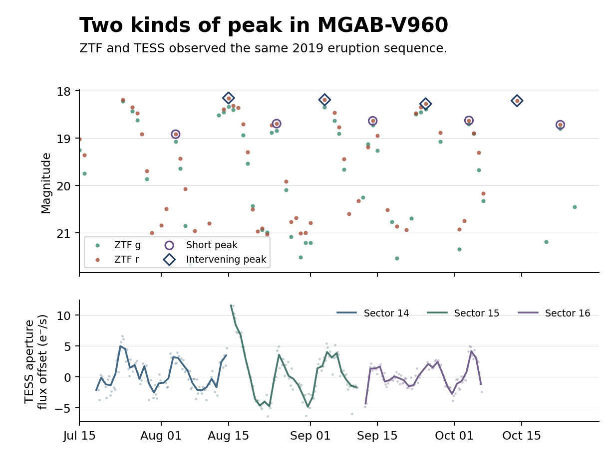
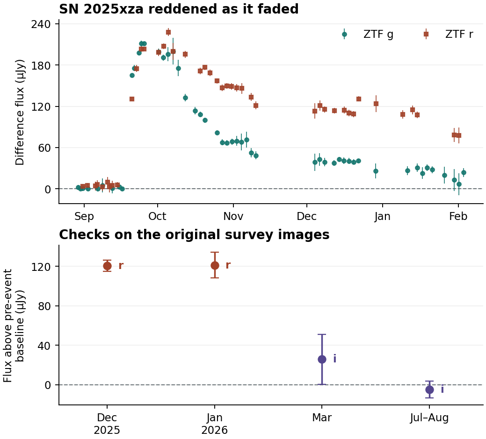

# Where did the fifth search add evidence?

**Three familiar objects yielded three different results.** Pan-STARRS recorded MGAB-V306 in a bright state in 2013. TESS independently recorded eruptions during a season of alternating peak strengths in MGAB-V960. For the known Type II supernova SN 2025xza we measured how long its red light persisted and examined the same position in Hubble images taken three years before the explosion. Each source had an earlier identification. Priority for an individual archival measurement remains open beyond the records checked here. [Source identities and prior reports](catalog/README.md) · [Independent first readings](investigator.md) · [Skeptic’s first readings](skeptic.md)

## A bright state six years before the dwarf nova report

On **November 3, 2013**, Pan-STARRS measured MGAB-V306 at **z = 16.617 ± 0.006 and y = 16.604 ± 0.010** half an hour apart. At its fixed sky position the source was 2.79 mag brighter in z and 2.09 mag brighter in y than its other same-filter reference dates, about 13 and 7 times their fluxes. Eight comparison stars on each exposure changed by at most 0.052 mag. This extends the measured bright-state record before Murawski’s 2019 submission and the ZTF-era eruption study. The two reductions use the same original exposures. Only one night caught this state, so the peak, duration and proposed dwarf-nova subtype remain open. The previously registered two-band, two-date test returned no qualifying pair for either dwarf nova. [Pan-STARRS measurements, comparison stars and discoverer’s chart](catalog/README.md) · [Szkody et al.](https://arxiv.org/abs/2002.08447)

## A dwarf nova that alternated for one season

MGAB-V960’s discovery chart already shows repeated peaks in 2019. Five short ZTF eruptions between August 4 and October 23 had measured red peaks of **18.63–18.92 mag**. Four interleaved brightenings reached **18.15–18.28 mag**. The short events were 20, 21, 20 and 19 days apart. A return near the ordinary level brackets each short event within seven days. These are observed brightnesses at the survey cadence. The true maxima can fall between visits. [Exposure dates, fluxes and the discoverer’s chart](catalog/README.md) · [Test and full event list](variables/README.md)

TESS observed the same field in three consecutive sectors. After a local background correction its central flux tracked the ZTF red measurements in each sector, with rank correlations of 0.77, 0.95 and 0.84. Across the TESS coverage beginning in July, four stronger event appearances and the weaker October 4 event localized within one TESS pixel. Several other faint dates remained confused. Across the independent years, 21 of 39 links between nearby bright groups alternated in strength, equal to the permutation expectation of 21.0. The alternating sequence is a finding about one season. A stable clock or a new subtype would require further evidence. [TESS pixels, timing controls and other seasons](variables/README.md)



## Four months of red light from SN 2025xza

GOTO measured the supernova on September 18, 2025. ATLAS filed the discovery report, and ePESSTO+ obtained a Type II spectrum on September 21, before the September 22 packet selected here. The nearest catalog source alone gives a misleading host association. Subaru and DECam show the supernova on the southern disk of NGC 1037, 20.63″ from the nucleus. DESI measured the nucleus at z = 0.028368. [Transient Name Server](https://www.wis-tns.org/index.php/node/218482) · [Source chronology](catalog/README.md) · [Registered galaxy images and host spectrum](images/host/README.md)

In ZTF's signed photometry the pre-event-subtracted red flux averaged **200.0 ± 4.7 µJy** on seven nights from September 24 to October 12. Four nights from January 13 to February 1 still averaged **89.5 ± 10.0 µJy**, about 45% of that early value. The green flux fell from 189.1 ± 8.4 to 20.5 ± 4.2 µJy in the corresponding windows. The late red measurements span days 117–136 after the first GOTO exposure. The two endpoints shared the same detector and reference within each band. [Signed fluxes, baselines and near-simultaneous colors](results/light-curve.json) · [Public alert light curve](https://alerce.online/object/ZTF25absffwy)



On the original survey images, **six December r nights** were 120.5 ± 5.8 µJy above the seeing-matched baseline. January 15 gave 121.2 ± 12.9 µJy above its baseline. The next useful original image was in a different filter. On **March 2**, the i-band excess was 25.7 ± 25.2 µJy, and the six July–August i nights together gave −4.9 ± 8.4 µJy. These measurements leave the date of the red decline unresolved. The sparse field initially defeated two reference-star selections. Eight more distant standards on the identical exposures allowed all 38 target images to be measured. Eight offset apertures track changes in the underlying galaxy and sky. The original r images and broker light curve share the ZTF telescope. [Image selection and calibration history](light-curve-protocol.md) · [Measurements and controls](results/field-calibrated.json)

How unusual is the surviving red light? In the preselected bright Type II/IIP panel, 23 of 24 objects passed the identity audit. **Zero** met the primary late-time coverage and baseline requirements. Allowing one to three pre-event nights with baseline error below 5% of the early flux yielded six comparisons at days 115–150. Their late fractions ranged from 0.10 to 0.32, below this source’s 0.45. Four retained at least two baseline nights. The sample favors bright explosions with late broker coverage, and the clocks use reported discovery times. It cannot establish the population rarity of this supernova. [All controls, failures and sensitivity runs](results/type-ii.json)

**What did Hubble see before the explosion?** The 2022 WFC3 images show several faint sources on structured light. Four Gaia stars tied the images to the sky with a largest residual of 0.030″. A 0.15″ aperture at the later event position gives **2.58 local standard deviations in each filter**, with 5σ aperture depths of F555W = 26.23 and F814W = 26.09 AB. Underlying galaxy structure affects both filters. The nearest accepted source is 0.394″ away and has an extended-source flag. The individual progenitor remains unidentified. [Registered Hubble field, depth definition and local controls](images/host/hst/README.md)

## Coverage and replay

The 2025 archive contains 2,110 in-window packets from 974 ZTF IDs on 211 dates. The sampling rule selected 132 IDs, with usable histories for 131. Of 74 IDs passing at least one brightness route, some were prior cases or controls. With the fifth packet reviewed, **53 unique eligible positions remain**, all on the recurring or fading routes. An independent run in 2024 supplied two new onset candidates for review. [Frozen queue](results/report.md) · [2024 search](../../compass-2024/README.md) · [Reusable compass](../../../DISCOVERY_COMPASS.md)

From the repository root, replay the frozen evidence without network access. The second command also checks original-image photometry, Hubble registration and the independent light curves. It needs NumPy, SciPy, Astropy and PyArrow. Figure regeneration additionally uses Matplotlib.

```sh
make verify-compass
python3 experiments/compass-2025/batch-5/verify.py --science
```
