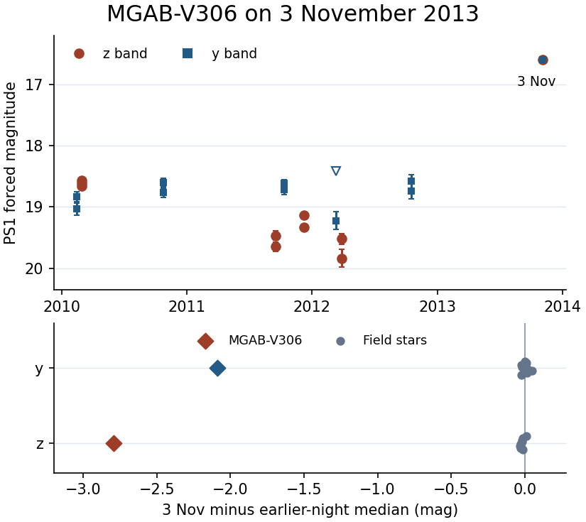

# Three catalog identities and a 2013 bright state

Pan-STARRS measured the known dwarf nova **MGAB-V306** in a bright state on **3 November 2013**, almost six years before its VSX discovery submission. These two historical exposures extend its observed eruption record into an earlier survey. The original discoverer’s chart shows later ZTF photometry, and Szkody et al. counted five outbursts in 449 days of ZTF observations. Neither source describes this Pan-STARRS date. The 2016 Catalina outburst catalog has no entry within 5″, and the AAVSO observer archive returns no measurements under MGAB-V306 for 2010–2014. Earlier reports under other identifiers could exist. [Discoverer’s chart](https://sites.google.com/view/mgab-astronomy/mgab-v301-v350) · [Szkody et al., Table 2](https://arxiv.org/abs/2002.08447) · [Catalina catalog](https://doi.org/10.1093/mnras/stv2921) · [archived queries](priors.json)



| 3 November 2013 | z | y |
|---|---:|---:|
| Exposure time (MJD, UTC) | 56599.6198194 | 56599.6409858 |
| Detection PSF magnitude (AB) | 16.6174 ± 0.0057 | 16.6042 ± 0.0095 |
| Distance from ZTF position | 0.087″ | 0.094″ |
| PSF major × minor FWHM | 1.60″ × 1.56″ | 1.59″ × 1.45″ |
| PSF-weighted unmasked fraction | 0.999 | 0.998 |
| Forced flux at fixed position (µJy) | 830.0 ± 4.4 | 832.6 ± 6.7 |
| Forced versus median of other nights (mag) | −2.793 (4 nights) | −2.087 (5 nights) |
| Largest absolute change in eight field stars (mag) | 0.031 | 0.052 |

The target has one PS1 mean source within 1″, ID 118791022581455340. The two exposures are 30.5 minutes apart. Aperture flux agrees with detection PSF flux to 0.008 mag in z and 0.023 mag in y. The fixed-position reduction uses the same exposures and provides a separate check on centroid fitting. Each comparison star shares the target’s actual skycell warp and has at least three usable other nights. The open triangle in the figure marks one 5σ depth. Resampled copies at identical times count once. [MAST PS1 archive](https://catalogs.mast.stsci.edu/panstarrs/) · [detection rows](118791022581455340.csv.gz) · [fixed-position raw rows](field-forced.csv.gz) · [comparison measurements](early-state.json)

These are the last usable z and y dates in this forced series. The closest earlier accepted dates in those filters were 586 and 384 days earlier, respectively. Later i and r detections on 25 and 26 November were near 19.65 and 20.15 mag. A same-filter onset time, peak and duration remain unconstrained. The original prespecified test called for two filters on both sides of a 1–10-day change. Neither MGAB-V306 nor MGAB-V960 had a single eligible pair at either quality threshold. The one-date bright state above arose from a subsequent exploratory check. [Protocol](ps1-protocol.md) · [coverage and magnitude ranges](ps1.json)

## Earlier classifications

* **ZTF17aaaoxxi = MGAB-V306.** Gabriel Murawski’s VSX discovery submission was registered on 25 September 2019. The 0.12″ catalog counterpart has a range of g = 16.6–21.5. Its 2021 VSX revision based on ZTF DR4 marked a tentative SU UMa subtype. VSNET used a tentative Z Cam designation in January 2025. Szkody et al. identified a strong CV candidate in ZTF, with no spectrum listed and five outbursts between g/r magnitude extremes of 16.6–20.1. No periodicity or spectroscopic subtype is established by these sources. [VSX and revision history](https://vsx.aavso.org/index.php?view=detail.top&oid=1498454) · [Szkody et al.](https://arxiv.org/abs/2002.08447) · [VSNET circular 8794](http://ooruri.kusastro.kyoto-u.ac.jp/mailarchive/vsnet-cvcirc/8794)
* **ZTF18abcckqd = MGAB-V960.** The VSX dwarf nova is 0.02″ away. Murawski’s submission was registered on 16 October 2019. VSX lists g = 18.3–21.5 with no period. His chart shows repeated bright episodes, including a sequence separated by approximately 20 days around reduced HJD 58690–58750. The discovery page lists g = 18.2–21.7 and gives no explicit interval. New timing analyses of this series need to distinguish measuring an interval more precisely from first reporting recurrent eruptions. [VSX and revision history](https://vsx.aavso.org/index.php?view=detail.top&oid=1499309) · [original light curve](https://sites.google.com/view/mgab-astronomy/mgab-v951-v1000)
* **ZTF25absffwy = SN 2025xza.** TNS credits ATLAS25lri, measured on 18 September 2025 at 21:57:55.872 UTC at orange = 18.839 and reported on 19 September at 07:18 UTC. The later-filed GOTO25hpa report includes an earlier 18 September 04:43:23.520 UTC observation at L = 19.61. Its preceding 17 September L = 18.8 limit was shallower than the detection. ZTF measured r = 18.6037 on 20 September. LAST and Pan-STARRS also reported detections. On 21 September at 07:37 UTC, ePESSTO+ observed a spectrum with NTT/EFOSC2 and classified a Type II supernova at the NGC 1037 host redshift, z = 0.028. That classification preceded the 22 September packet anchor. CATS150 lists a 20.71″ (11.78 kpc) projected host offset. BTS lists peak r = 18.08. [TNS individual reports](https://www.wis-tns.org/index.php/node/218482) · [Warwick et al. classification](https://www.wis-tns.org/astronotes/astronote/2025-288) · [CATS150 measurements](https://cats150.caltech.edu/sources) · [staged TNS record](tns.csv.gz) · [BTS row](bts.csv.gz)

## Replay

Run in this directory with Python 3. The four checks validate source checksums and read the stored responses. Each supports `--fetch` for missing data. The TNS snapshot and discoverer pages store a selected row or text with the full-response and extract hashes. Image hashes identify the visually inspected discoverer charts. The fixed-position table stores every queried row for the selected ten field candidates and target in both bands.

```sh
python3 check.py | diff - results.json
python3 priors.py | diff - priors.json
python3 ps1.py | diff - ps1.json
python3 early_state.py | diff - early-state.json
python3 figure.py
```

Regenerating the figure requires Matplotlib. [Primary-source queries and analysis](priors.py) · [historical photometry](ps1.py) · [fixed-position and same-exposure checks](early_state.py)
