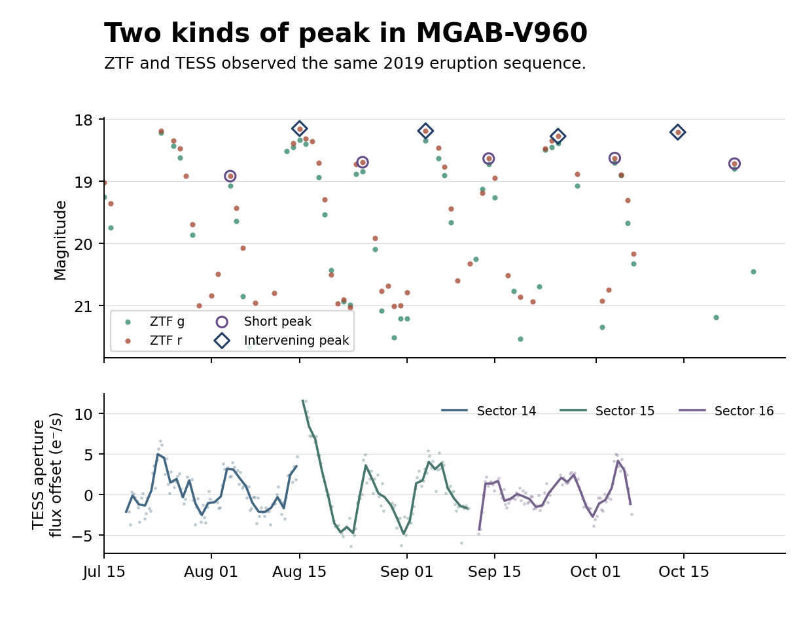

# How long did alternating eruptions persist in MGAB-V960?

**MGAB-V960 showed nine successive bright peaks of alternating measured strength over 80 days in 2019.** Five shorter, fainter peaks were separated by 19–21 days, with four distinctly brighter peaks between them. TESS independently located the variable light at the ZTF source in three consecutive sectors. The red-light measurements in other years allow ordinary runs of alternating events as often as the observed sample. The 2019 sequence describes one season in a known dwarf nova. [Per-event measurements](alternating.json) · [TESS pixel tests](tess-events.json)

Murawski's October 2019 discovery submission identified the dwarf nova and its chart already shows eruptions spaced by roughly 20 days. The VSX record gives no period. Our additional measurements quantify the intervening peaks, check several of the same eruptions with a space telescope and test how far the pattern transfers. [Original discovery chart](https://sites.google.com/view/mgab-astronomy/mgab-v951-v1000) · [VSX entry and revision history](https://vsx.aavso.org/index.php?view=detail.top&oid=1499309) · [Catalog review](../catalog/README.md)



## Nine peaks in ZTF, and a check by TESS

The five fainter maxima occurred on August 4, August 24, September 14, October 4 and October 23. Each was bounded by faint observations at most seven days apart. Their sampled peaks span **r = 18.63–18.92** and **g = 18.71–19.08**. The four intervening sampled maxima span **r = 18.15–18.28** and **g = 18.33–18.39** where measured. Lower magnitudes indicate brighter light. The first three short-event starts imply a linear interval of 20.5 days; the last two arrived 0.33 and 1.83 days early. All five dates were already visible when the sequence was selected. Sampling gaps can hide individual maxima. [Original duration test](duration-protocol.md) · [Frozen phase test](recurrence-protocol.md) · [Two-band peak measurements](alternating.json)

TESS observed the position from July 18 to October 6. The brightest pixel in an uncorrected difference image lay 3–5.5 pixels from the source, raising a crowding or background concern. After registering a second extraction, we removed four shared trends fitted from the outer 56 of 81 pixels, excluding ±1.5 days around the ZTF-selected peak dates from the fit. Each sector's corrected bright-minus-faint image, selected using ZTF brightness, peaks within 0.63 TESS pixel of the target. One pixel subtends approximately 21″, so a very close blend remains possible. [Correction and timing-shift protocol](alternating-protocol.md) · [Flight data and original checks](tess.json) · [TESSCut at MAST](https://mast.stsci.edu/tesscut/)

| TESS sector | Clean cadences | Matched ZTF dates, r / g | Corrected brightness rank correlation, r / g | Brightest difference pixel, r / g |
| --- | ---: | ---: | ---: | ---: |
| 14 | 1,237 | 13 / 11 | 0.77 / 0.77 | 0.51 / 0.51 pixel |
| 15 | 1,190 | 20 / 17 | 0.95 / 0.88 | 0.62 / 0.62 pixel |
| 16 | 1,118 | 14 / 14 | 0.84 / 0.79 | 0.44 / 0.44 pixel |

Differences against nearby faint dates localize the stronger July 24, August 13–15, September 4 and September 23 groups within 0.93 pixel. July 24 preceded the nine-peak sequence and August 13–15 straddled two sectors. Of the individually tested weaker peaks, October 4 localized and August 4, August 24 and September 14 did not. TESS ended before the final October 14 and 23 peaks. The ZTF time series supplies the measured strength ordering. We also tested 100 circular shifts of the six-hour TESS images per sector, repeating the trend correction and checking both ZTF bands. The true alignment was the only common shift to pass in all three sectors. The shifts are correlated controls. [Individual peak images and aperture fluxes](tess-events.json) · [All timing-shift results](checks.json)

## What repeated in other seasons?

The original blind 0.1–1,000-day search on the first two thirds of ZTF red dates failed to predict subsequent red or green magnitudes. After identifying the 2019 sequence, we tested its frozen strength boundaries in every other year. Of 39 red event-to-event links separated by 5–15 days and an observed faint return, 21 joined different strengths. Permuting observed strengths 5,000 times within year and coverage strata gave a mean of 21.0. The green result was 20/32 versus a mean of 17.5. Only two red links retained two red observations per bright group in both events. A constant alternation beyond 2019 remains unsupported. [Timing search](results.json) · [Other years and permutations](alternating.json)

Red and green both had smaller flux differences after 17–23 days than in two comparison windows in four of six eligible years outside 2019. Independent ASAS-SN forced photometry passed this lag test in one of five eligible years outside 2019. In a separate within-season forecast, seven early red seasonal samples were each searched at 501 frequencies over 14–26 days; none predicted the later red or green data at the fixed thresholds. In 2019 the ASAS-SN flux had the same sign of peak-versus-half-phase contrast as ZTF, but 69 of 100 phase shifts scored at least as high. The ASAS-SN field supplied no 30–60″ comparison source within a factor of two of the target's flux, and cameras gave inconsistent contrasts. [Phase ranks, lag counts and seasonal forecasts](cadence.json)

An August 19, 2020 half-year split selected on red data showed a 0.90-mag increase in r and a 0.76-mag increase in g. ASAS-SN also rose by 0.067 mJy in the same windows. Six nearby ZTF stars each changed by less than 0.07 mag. However, the target was missing on 10/40 earlier and 11/40 later red field dates, and on 8/38 earlier and 13/32 later green dates. Assigning the missing dates to the bright or faint state gives overlapping bright-visit fractions. The duty cycle and the underlying quiescent level cannot be separated with these measurements. [State and field-calendar results](checks.json)

## MGAB-V306 has observed 10–16-day bright runs

For the other dwarf nova in the batch, the primary threshold found four bright runs with at least four nights, observed spans of 10–16 days, and no gap over five days. The November 12–27, 2020 run lay between faint visits 44 days apart. Two fall 2023 runs share faint brackets 528 days apart and might be fragments of one episode. Changing the bright threshold or gap admitted two to five long groups. No event in this object was bracketed by faint visits at most seven days apart. MGAB-V960 had 13 such short groups, and its count of long groups varied from zero to five under threshold changes. The proposed two-duration test required both classes at the primary cuts in a single source; neither object met that condition. [All groups and sensitivity settings](duration.json)

MGAB-V306 was already known to erupt. Its 2019 discovery chart shows a prolonged bright interval; Szkody et al. counted five outbursts over 449 days. Its VSX subclass is tentative. A separate catalog analysis recovered an earlier bright state in Pan-STARRS on November 3, 2013. The ASAS-SN catalog contains a counterpart within 0.09″ but returned zero photometric rows. TESS sectors 6, 33 and 87 covered different dates from the four primary long groups. None provided both a ≥5-day bright plateau and reliable source localization, leaving zero qualifying superhump searches. These data cannot resolve the subclass. [Published records and 2013 Pan-STARRS measurements](../catalog/README.md) · [TESS coverage and plateau criteria](tess-protocol.md) · [Results](tess-events.json)

## Reproduce the measurements

MGAB-V306 has 362 clean red and 224 clean green ZTF dates through its anchor. MGAB-V960 has 480 red and 456 green dates. The third batch position, SN 2025xza, had no DR24 source within 1.5″. Six TESS cutouts preserve quality-zero measurements in losslessly compressed 9 × 9 pixel cubes with timestamps, original file hashes, pointing, and archive URLs. The data folder is approximately 5.8 MiB including ZTF comparison stars and ASAS-SN data. The onset and catalog analyses are documented separately. [Direct source retrieval](../results/direct.json) · [Local source captures](sources/) · [Initial protocol](protocol.md)

Run in this directory with Python 3.10 or newer, NumPy, SciPy, Astropy, Requests, PyArrow and Matplotlib. The commands read frozen data by default. Numeric scripts and the figure accept an output path for verification.

```sh
python analyze_vars.py --out /tmp/b5-vars-results.json
python duration.py --out /tmp/b5-vars-duration.json
python cadence.py --out /tmp/b5-vars-cadence.json
python alternating.py --out /tmp/b5-vars-alternating.json
python tess_data.py --out /tmp/b5-vars-tess.json
python tess_events.py --out /tmp/b5-vars-tess-events.json
python checks.py --out /tmp/b5-vars-checks.json
python figure.py --out /tmp/b5-vars-mgab-v960.png
```

The duration, cadence, TESS data and checks programs also accept `--fetch` to acquire missing public input files. Each offline result compares unique source dates; repeat detections do not increase a nightly sample count. [ASAS-SN Sky Patrol](https://asas-sn.osu.edu/skypatrol) · [ZTF data service](https://irsa.ipac.caltech.edu/Missions/ztf.html)
