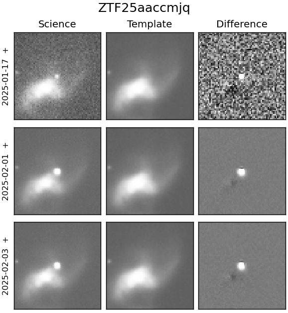

# Where did the light change?

Each case has three dated science, reference and difference-image triplets from Fink. We used the earliest and middle eligible prior dates in the anchor band plus the anchor. The broker displays each image with its own intensity stretch. The labels give the archived sign of the difference flux. Use the reported photometry to compare fluxes across nights. [Initial skeptic predictions](../skeptic.md) · [Selection and image hashes](check.py)

**Recent onset, ZTF25aaccmjq.** The template contains an extended bright object. The February 1 and 3 science exposures clearly show a separate point-like peak displaced from its bright center, with a compact positive difference residual at the peak. The January 17 residual is noisier. Gaia DR3 returned two rows in the 60″ cone and zero within 5″ of the alert. This morphology favors a transient superimposed on extended light. Redshift and physical host membership require separate evidence. [Nine source stamps](ZTF25aaccmjq/epochs/gallery.md) · [Archive request](ZTF25aaccmjq/gaia.json)

**Repeated bright detections, ZTF18abodmfy.** Both polarities lie close to Gaia DR3 463350318963210624, the sole catalog entry in the 5″ neighborhood. The propagated star is 0.084″ from the anchor. The median radial offsets of positive and negative detections were 0.167″ on 250 dates and 0.085″ on 109 dates. The images show the source at a fixed central position in a field of stars. The August 2025 positive residual is compact and bright. These data favor changes at this star's position. Resolving separate outbursts requires brightness measurements between them. [Nine source stamps](ZTF18abodmfy/epochs/gallery.md) · [Gaia request](ZTF18abodmfy/gaia.json) · [Visual comparison](ZTF18abodmfy/montage.png)

**Repeated fading, ZTF18aazenpc.** The sole Gaia star within 5″ is DR3 1868798617634638592, 0.009″ from the anchor after propagation. The median radial offsets are 0.194″ for positive residuals on 266 dates and 0.229″ for negative residuals on 227 dates. In the 2019 and 2022 negative exposures the residual is compact amid other subtraction structure. The 2025 positive residual at the same central star is much brighter. [Nine source stamps](ZTF18aazenpc/epochs/gallery.md) · [Gaia request](ZTF18aazenpc/gaia.json) · [Visual comparison](ZTF18aazenpc/montage.png)

The positive and negative positions of the fading candidate are close to the same Gaia star but show a small directional difference. After observing the pooled shift, we grouped dates by calendar year and filter, keeping groups with at least three dates of each sign. Independent nightly medians within each of eleven eligible groups placed the positive centroid south of the negative centroid. The equal-group median positive-minus-negative shift was 0.039″ east and 0.261″ south. A color- or seeing-dependent centroid error, an unresolved neighbor or subtraction against a structured reference could contribute. The signed images alone cannot assign the variability to an individual component. The corresponding shift for the recurrent candidate was 0.107″ across four eligible groups. [Per-year and filter breakdown](centroid_check.json)

The 60″ Gaia cones at reference epoch J2016 contained 2, 36 and 99 entries for these respective cases. Applying the pilot's significant-motion criterion and 2.5″ track tolerance produced zero matches. For each nearby star we propagated the catalog position to each alert date using its reported proper motion. Where a date supplied several measurements of the same sign, we took their median separation, then reported medians across dates. A date can appear in both sign groups. The angular offsets omit parallax. [Full measurements](results.json) · [Gaia data access](https://irsa.ipac.caltech.edu/data/Gaia/)

From the repository root, `python3 experiments/compass-2025/images/check.py` checks the three image sequences and catalog receipts and reproduces the measurements offline. `centroid_check.py` reproduces the sign-dependent offsets. Run `figure.py` with Matplotlib to rebuild the montages from the archived PNGs.

The later astrometric search used the same Gaia and image machinery on four prespecified held-out exposures for ZTF18adjrqpw. Run `python3 experiments/compass-2025/images/offset_case.py` for those measurements. [Astrometric case interpretation and images](../astrometry/skeptic.md)
