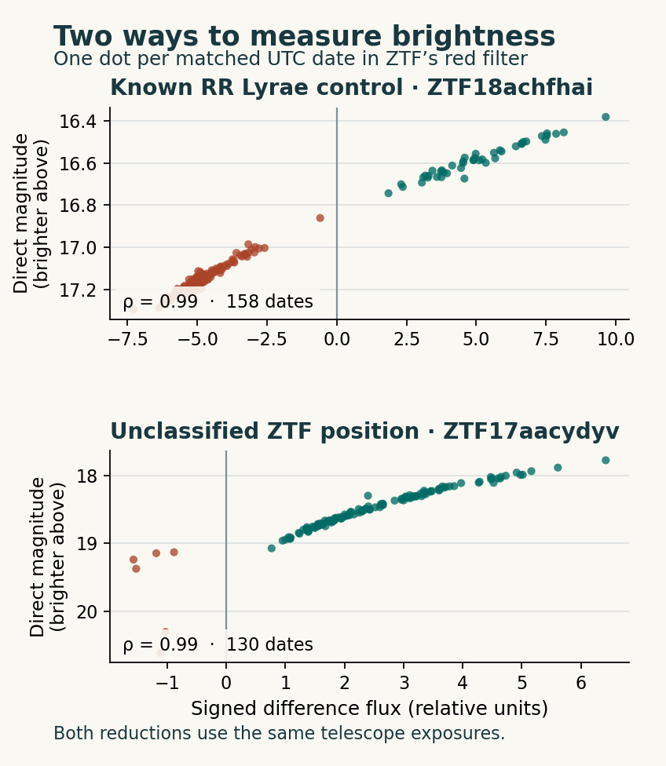
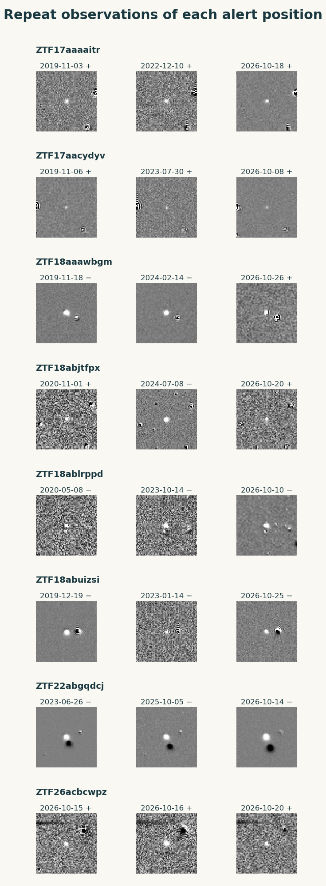

# Which October alerts still change brightness under a second measurement?

**We followed all 130 distinct ZTF identifiers in Fink’s October 2026 anomaly archive.** The frozen screen admitted 20 objects. A variable-star catalog supplied counterparts for 14. Of the six that remained, one was already a spectroscopically classified supernova and five recur near Gaia stars. A separate audit of historical catalog-service failures added a sixth long-lived position. None of these results establishes a new astronomical object. [Per-ID outcomes](results/outcomes.csv) · [Month-level counts](results/summary.json) · [Discrepancy ledger](../../DISCREPANCIES.md)

ZTF measures changes by subtracting a reference image from a later exposure. This makes brief explosions visible alongside variable stars, blends of nearby sources and subtraction artifacts. Fink already prioritizes unusual alerts and its team has studied them with dedicated follow-up observations. Our question was whether a reproducible, modestly sized set of public checks could explain previously reported objects and isolate the measurements that still warrant attention. [ZTF image processing](https://arxiv.org/abs/1902.01872) · [Fink’s earlier anomaly investigations](https://arxiv.org/abs/2603.29511)

## The full month and the original sample

Fink returned 190 anomaly packets on 19 UTC dates from October 1 through October 31. They represented 130 distinct ZTF IDs. The separate science-alert statistics counted 1,655,912 alerts on 23 observing nights. This census covers the archived anomaly list and inherits its observing cadence, score selection and daily limits. The seven reused controls reproduced exactly, with four published moving stars recovered by Gaia ID and three known supernovae unflagged. That gate measures recovery on these specific controls. It cannot estimate the missed-source rate across the telescope survey. [Frozen extension protocol and membership](protocol.md) · [Coverage and observing-night data](../replication/coverage/coverage.json)

| First-pass disposition | Earlier 20 | Remaining 110 | All 130 | Follow-up |
|---|---:|---:|---:|---|
| Catalog context | 11 | 74 | 85 | Current SIMBAD counterparts |
| Historical broker crossmatch failed | 5 | 16 | 21 | 18 with SIMBAD neighbors, two additional VSX counterparts, one sent to the deeper audit |
| Admitted for catalog review | 4 | 16 | 20 | 14 unique VSX counterparts within 1″, six with empty VSX cones |
| Insufficient quality or positive dates | 0 | 3 | 3 | Two low-quality selected packets and one history with zero positive dates |
| Significant Gaia moving-star track | 0 | 1 | 1 | Reference dates and image sequence support subtraction at the star’s former position |

Each object contributes once to this table. A matched catalog position can explain why a source is already familiar while leaving its activity unexplained. The failed lookup for ZTF18ablrppd preceded the anchor quality check and its anchor DRB was 0.561, below the required 0.8. It remains a separate audit object in every total. The three quality-gate exclusions were never promoted to catalog review. [Frozen initial 20](../replication/2026-10/results/summary.md) · [Measurements for all remaining 110](results/remainder.json) · [All final dispositions](results/outcomes.csv)

## A second brightness measurement

Consider ZTF17aacydyv. The Gaia star lies 0.221″ from the alert after accounting for its motion. Neither the Gaia variability classification, VSX nor the two Chen et al. ZTF tables returned a variable in their 5″ cones. Yet the alert history shows a central residual on images years apart. A star can appear in a position catalog without appearing in a particular variability catalog, and a fainter neighbor can share the telescope's resolution element. [Catalog response](sources/extended/ZTF17aacydyv.json) · [Gaia classification table](https://gaia.aip.de/metadata/gaiadr3/vari_classifier_result/) · [Chen et al. catalog](https://arxiv.org/abs/2005.08662) · [VSX](https://vsx.aavso.org/)

We registered a second test. Does the light measured directly on the original images grow brighter on the same dates as the difference-image residual? The graph shows a known RR Lyrae control and this unclassified position. The horizontal coordinate measures signed difference flux. The vertical coordinate measures the source's direct apparent magnitude, with brighter values higher on the page. Each dot represents one matched red-band UTC date. [Test registered before direct data retrieval](photometry-protocol.md) · [IRSA light-curve API](https://irsa.ipac.caltech.edu/docs/program_interface/ztf_lightcurve_api.html)



For ZTF17aacydyv the rank correlation was 0.995. The direct median was 0.805 mag brighter on its 124 positive-residual dates than on its six negative dates. An independent model reviewer had favored a long-lived variable near the Gaia position before seeing this test. The direct result supports variability at the position. The images still blend light within the telescope’s resolution and both reductions used the same exposures. **The identity of the varying star and its physical class remain open.** [Independent review](review/ZTF17aacydyv/independent-review.md) · [Independent infrared measurements with NEOWISE](infrared/README.md) · [Source data](sources/direct/ZTF17aacydyv.json) · [Graphic source](../../figures/october_census.py)

All six positions passed the registered direct-image test. Their nearest Gaia positions, propagated to each alert epoch, lie 0.027″ to 0.268″ from the alert. The positions with multiple Gaia neighbors make especially clear targets for deblended photometry.

| Position | Positive / negative dates | Rank correlation | Direct median gap (mag) | Gaia offset at alert |
|---|---:|---:|---:|---:|
| [RR Lyrae control](https://ztf.fink-portal.org/ZTF18achfhai) | 44 / 114 | 0.986 | 0.567 | — |
| [ZTF17aaaaitr](review/ZTF17aaaaitr/images/gallery.md) | 175 / 18 | 0.899 | 0.831 | 0.105″ |
| [ZTF17aacydyv](review/ZTF17aacydyv/images/gallery.md) | 124 / 6 | 0.995 | 0.805 | 0.221″ |
| [ZTF18aaawbgm](review/ZTF18aaawbgm/images/gallery.md) | 37 / 6 | 0.817 | 1.462 | 0.268″ |
| [ZTF18abjtfpx](review/ZTF18abjtfpx/images/gallery.md) | 19 / 24 | 0.943 | 0.982 | 0.254″ |
| [ZTF18ablrppd](review/ZTF18ablrppd/images/gallery.md) (failure audit) | 77 / 64 | 0.995 | 0.633 | 0.027″ |
| [ZTF18abuizsi](review/ZTF18abuizsi/images/gallery.md) | 26 / 9 | 0.946 | 1.949 | 0.079″ |

The date counts refer only to pairs present in the public direct-image archive and an alert history through its selected packet. Many telescope exposures never trigger an alert. A strong rank correlation on this conditioned subset does not provide a variability rate, a period or an astrophysical class. The median difference in direct magnitudes is computed only with at least five positive and five negative dates. [All direct results and control](results/direct.json)

## Two explanations the catalog filter missed

* **An already classified supernova.** ZTF26acbcwpz passed the first and second catalog screens. Its selected alert had no TNS name, while its stellar catalog cones were empty. The Caltech LIONS table explicitly maps the ZTF identifier to SN 2026afgd. TNS records a Type Ia classification with an October 14 P60/SEDM spectrum. [TNS record](https://www.wis-tns.org/object/2026afgd) · [Caltech’s October list](https://sites.astro.caltech.edu/LIONS/mag_bins_pub/2026-10-le18_0.html) · [Archived evidence](sources/registry/sn-2026afgd.json)
* **A star at its old position.** G 143-8 moves about 1.49″ per year. Its track misses the alert centroid of ZTF22abgqdcj by only 0.059″. The inferred crossing, around July 21, 2018, falls inside the measured April 22–August 18 exposure interval used to build the reference. All 325 quality-selected detections through the anchor were negative. Images in 2023, 2025 and 2026 show the paired residual expected from that displacement. A registered image fit could still reveal a superposed source. [Reference dates and Gaia calculation](review/ZTF22abgqdcj/reference/report.md) · [Science, template and difference images](review/ZTF22abgqdcj/images/gallery.md)



The + or − above each stamp gives the archived photometric sign. Displays are individually stretched. Compare morphology within a row and use the photometry for brightness. The supplementary images link each date to its science, template and difference exposures. [All eight source galleries](review/) · [Object-specific alternative explanations and next observations](results/discrepancies.json)

## Replay offline

Run these commands from the repository root.

```sh
python3 census.py
python3 census_followup.py
python3 census_photometry.py
python3 census_report.py
make verify
```

The first three commands regenerate the 110-object primary analysis, the extended catalogs and image validation, and the direct-image comparison. The fourth recomputes each case from frozen source responses, merges the earlier sample, and emits a per-ID CSV, counts, discrepancy ledger and two review packets. Adding `--fetch` to the first three commands fills missing source responses. Two positional requests timed out. For these we retained the same 1.5″ cone, red band and minimum observations, resolved every matching IRSA DR24 series ID by TAP, then retrieved the light curves by ID with the same time and quality filters. Both routes use the service’s original UTC MJD and exposure IDs. The bounded recovery can be repeated with `python3 census_direct_recovery.py OBJECT_ID`. [Recovery queries and receipts](sources/direct/recovery/) Replies carry original query URLs or parameters, retrieval times and hashes. The independent registry note preserves its source links and the extracted classification fields. Raw photometry and histories reproduce the plotted points with the optional Matplotlib/Pillow script. [Raw source archive](sources/) · [Agent review workflow](../../agents/README.md)
