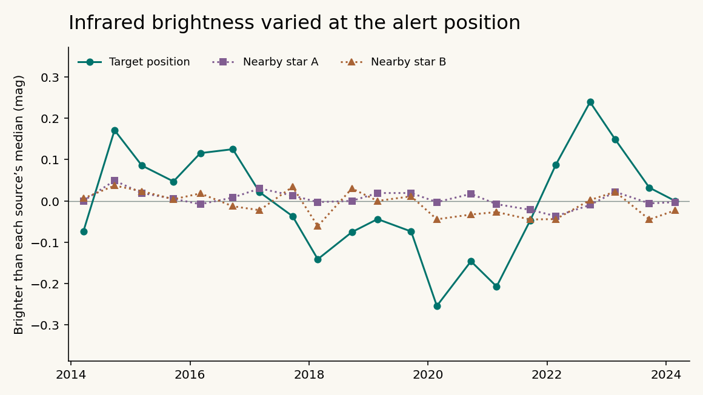

# A second telescope measures the unclassified alert position

Across 21 visits between March 2014 and February 2024, NEOWISE’s infrared brightness at the position of ZTF17aacydyv varied more than that of two nearby, similarly bright stars. The infrared match in AllWISE lies 0.345″ from the optical alert position. This gives an independent measurement of changing flux from that patch of sky. WISE's W1 beam is about 6″ wide, so a blended neighbor could contribute. The optical and infrared changes need not come from the same star. [ZTF candidate and direct-image test](../README.md) · [AllWISE catalog and variability flags](https://irsa.ipac.caltech.edu/data/WISE/docs/release/AllWISE/expsup/sec2_1a.html) · [NEOWISE single exposures](https://irsa.ipac.caltech.edu/data/WISE/docs/release/NEOWISE/expsup/sec2_1a.html)

| AllWISE designation | Retained / retrieved W1 exposures | Visits | Full range of visit medians (mag) | Central 80% span (mag) |
|---|---:|---:|---:|---:|
| J054854.20+265147.6, target | 236 / 260 | 21 | 0.493 | 0.295 |
| J054852.71+265123.2, comparison A | 236 / 260 | 21 | 0.086 | 0.032 |
| J054856.62+265119.5, comparison B | 238 / 262 | 21 | 0.098 | 0.075 |

The original AllWISE catalog four-band variability flag is `11nn`. The single-exposure archive lets us test a much longer time span. We chose this optical position after its direct-image result and froze the infrared selection rules before reading any of its NEOWISE exposures. Two controls give a local comparison; they give little leverage to estimate population-wide false-positive rates. Higher-resolution imaging during bright and faint phases could localize the variable component. [Frozen selection rule](PROTOCOL.md) · [Query URLs, hashes and coverage](sources.json) · [Individual visits](results.json)

From this directory, `python3 compare.py` reproduces the JSON on standard output without network or third-party packages. The Gator table headers record their row counts. An independent download through IRSA TAP reproduced all 63 visit medians. To rebuild the graphic, use Matplotlib with `python3 figure.py`. [Archive query interface](https://irsa.ipac.caltech.edu/applications/Gator/GatorAid/irsa/catsearch.html)
