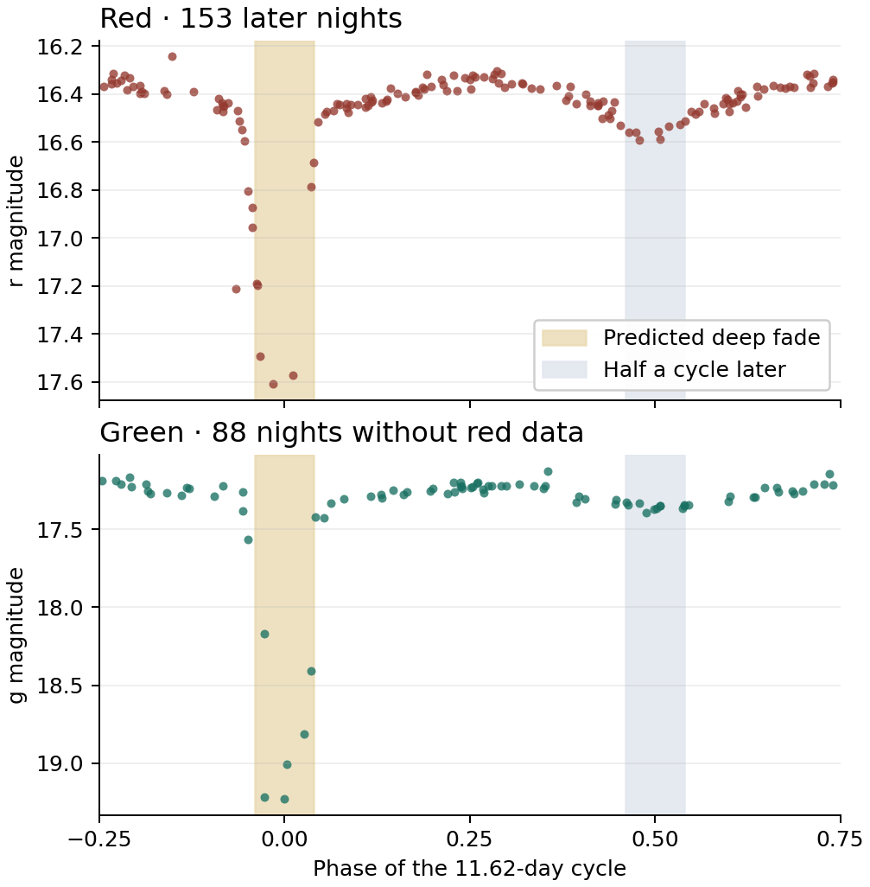

# A deep fade every 11.62 days at ZTF18abjtfpx

Light near Gaia DR3 **4479632717757053440** fades deeply every **11.62 days**, with a much shallower minimum halfway through the cycle. That pattern makes this an eclipsing-binary candidate. In 2018 ATLAS flagged this position as a dubious variable and reported periods near 5.8 and 2.4 days. ALeRCE also finds 5.812 days in ZTF data, and one of its classifiers favors an Algol-type eclipsing binary with probability 0.424. The measurements here distinguish which alternate cycles contain the deep fade and locate the missing light. Priority for the doubled period across all catalogs remains unverified. [Published ATLAS row](https://vizier.cds.unistra.fr/viz-bin/VizieR-5?-source=J/AJ/156/241/table4&recno=2182150) · [ALeRCE features and classifications](../../november-search/prior/README.md) · [Fink alert and images](https://ztf.fink-portal.org/ZTF18abjtfpx)



## How the period emerged

The October pipeline had already tested 190 anomaly packets from 130 ZTF identifiers, finding six positions with independently reduced direct-image variability. We took those same six positions, plus a known RR Lyrae control, and searched all usable nights of their previously selected red series. A model fitted to the first two thirds had to predict the rest without changes to phase, amplitude or mean. The control passed at 0.50965 days. One of six candidate positions passed. At ZTF18abjtfpx the 5.81178-day waveform fitted on 304 nights lowered squared prediction error by 41% on the next 153 nights. On a further 26 red alert nights through October 20, 2026, its predicted brightness tracked the signed difference flux with rank correlation 0.723. These last nights are selected by the alert threshold. [Selection and thresholds](protocol.md) · [All seven timing results](results.json) · [Later alerts](epochs.json)

| ZTF position | Best training period (days) | Later nights | Error reduction | Rank correlation |
|---|---:|---:|---:|---:|
| ZTF18achfhai (RR Lyrae control) | 0.50965 | 106 | 71.1% | 0.885 |
| ZTF17aacydyv | 7.31355 | 157 | 4.3% | 0.248 |
| ZTF18aaawbgm | 1.57074 | 95 | 19.0% | 0.477 |
| **ZTF18abjtfpx** | **5.81178** | **153** | **41.0%** | **0.697** |
| ZTF17aaaaitr | 1.11325 | 126 | 38.2% | 0.582 |
| ZTF18ablrppd (outage audit) | 226.95136 | 187 | 4.7% | 0.488 |
| ZTF18abuizsi | 1.41686 | 172 | 16.3% | 0.381 |

The first cross-band check exposed a weakness in the 5.81-day model. On 30 green nights reserved for validation, translating the red waveform by a constant color offset reduced squared error by 21.8%, short of the registered 30% threshold. Daily aliases also predicted some red variation. A two-harmonic model at twice the period approached the original model's later-night error. On inspection, the deepest red measurements were concentrated in a narrow phase interval. That observation, including the already examined later red nights, motivated an exploratory search for alternating dips. [Green result and field controls](green/README.md) · [Comparison with aliases and catalog periods](alternatives.json)

## Predicting which nights go faint

We fitted box-shaped dips to the original 304 training nights, allowing the period, phase and width to vary. The **11.62356-day** fit beat the 5.81-day clock, the two first sidereal-day aliases and the shorter harmonic on training likelihood. Its window was 0.93 days wide, centered at HJD 2458210.38245 plus an integer number of cycles. These digits specify the reproducible fit. An uncertainty in the orbital period has yet to be established. [Fit protocol and selection history](dips-protocol.md) · [All five fits](dips.json)

We carried that exact window into a second ZTF red field and the green exposures. The table gives median apparent magnitudes, with the number of nights in parentheses. A higher magnitude means a fainter source.

| Observations | Predicted deep fade | Half a cycle later | Outside both windows |
|---|---:|---:|---:|
| Original red field, later nights | 17.20 (7) | 16.56 (7) | 16.40 (139) |
| Second red field, dates absent from the first | 17.49 (3) | 16.58 (5) | 16.40 (21) |
| Green, dates absent from both red fields | 18.91 (6) | 17.35 (11) | 17.25 (71) |

Across the green dates, the two nearby comparison stars showed median differences of only +0.001 and −0.015 mag between the predicted deep and half-cycle windows. The target's **1.56 mag** difference corresponds to about **76% less green flux** at the deep minimum. These are dates from the same ZTF survey. A red or green image can include more than one star. [Window comparisons, control stars and dates](dip-check/README.md) · [Plot source](figure.py)

The negative difference images locate the light that disappeared. Across 41 dates the residual centroid lay a median **0.101″** from the nearest Gaia star after accounting for motion. The other two Gaia entries in the 5″ cone lay a median 2.62″ and 3.72″ away. This favors a varying component at the brightest Gaia position. A spatially unresolved companion is plausible. Spectra at opposite orbital phases could test for orbital velocity changes. Sharp images during a deep fade and outside it would directly localize the varying component. [Centroid measurements](centroids.json) · [Three epochs of science, template and difference images](../review/ZTF18abjtfpx/images/gallery.md)

## Checks from other telescopes

Earlier Pan-STARRS measurements give mixed results when extrapolating the frozen red phase over several years. The rank correlations are −0.49, +0.50, −0.30 and +0.80 in g, i, z and y, with only 5–9 nights per band. The red band has four usable nights. A separate fit allowing a free phase favors a roughly 5.8-day modulation at the nearest resolved source over the 2.408-day ATLAS alternative. A nearby fainter source has insufficient coverage. [Earlier epochs and selection](followup.md) · [Pan-STARRS data and fixed-phase comparison](epochs.json) · [Resolved-neighbor comparison](catalog/README.md)

TESS observed the field for 26 days in sector 80. A fitted 5.81-day sinusoid reduced central-aperture squared error by 15.1%, compared with 0.6% at 2.408 days. Its rank agreement with the unchanged ZTF waveform was only 0.20. One predicted deep fade fell in a gap. The other had a small central deficit and larger fluctuations in the corner apertures. This sector offers little independent evidence for alternating eclipse depths. [Aperture reduction and source FITS receipt](tess-source.json) · [All aperture comparisons](tess.json) · [Individual predicted windows](tess-windows.json)

For the earlier infrared lead, ZTF17aacydyv, 11 optical and infrared visits matched within ±10 days. Its W1 and red rank correlation was 0.25. The two telescopes had measured variability at that position, but their matched visits provide little evidence of synchronized changes. [All visit pairs and leave-one-out checks](results.json)

## Reproduce the measurements

With Python, NumPy, SciPy and Astropy, run the following from the repository root. The verifier recomputes the period search, catalog comparisons, predictions and centroid offsets from the local source archive. The optional plot uses Matplotlib.

```sh
python3 experiments/october-census/timing/verify.py
python3 experiments/october-census/timing/figure.py
```

The numerical replay used NumPy 1.26.4, SciPy 1.13.1 and Astropy 6.1.0. The archive includes the reduced TESS aperture series and the exact MAST cutout request. To repeat the pixel extraction, download that ZIP and run `space.py --extract PATH_TO_ZIP` in this directory. [ZTF light-curve archive](https://irsa.ipac.caltech.edu/docs/program_interface/ztf_lightcurve_api.html) · [Pan-STARRS DR2 interface](https://catalogs.mast.stsci.edu/docs/panstarrs.html) · [TESSCut](https://mast.stsci.edu/tesscut/)
