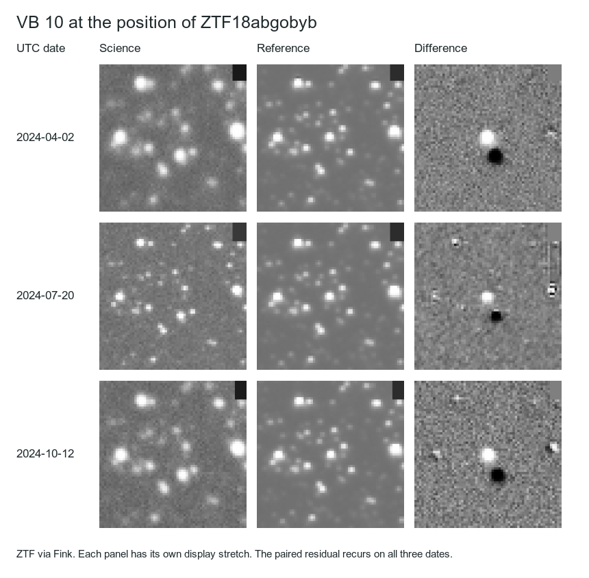

# Two checks against the original images

## The moving-star prediction

For ZTF18abgobyb the moving-star screen predicted that the telescope would have seen VB 10 at the residual position during the reference exposures in spring 2018. Its present position should have shifted enough to leave a pair of opposite-sign spots when subtracting the reference. [Astrometric calculation and coadd dates](../results/moving-star/report.md)

The coordinator inspected the same filter on three UTC dates in 2024. All three difference images show a compact bright–dark pair with the same orientation near the center. The corresponding sources in the science and reference images appear displaced in the same direction. Each of the three packets has negative polarity at the alert position. The repeated morphology and the independently recovered coadd interval support foreground motion as the explanation. Precise registration against the Gaia positions in original FITS images would test the remaining possibility of a superposed source. [Three epochs, original URLs and candidate IDs](ZTF18abgobyb/gallery.md) · [Gaia identification](https://simbad.cfa.harvard.edu/simbad/sim-id?Ident=Gaia+DR3+4293315765165489536)



## The highest-ranked initial candidate

ZTF17aaagxae lies 0.10 arcseconds from the VSX variable TCP J06515141-0310267. In the three selected epochs (2019, 2021 and 2024), the source visible near the center of the reference image is fainter in the science image, with a compact difference residual. The alert sign is negative in each case. Its alert magnitude describes the residual amplitude. A recorded transient at this position in 2020 supplies independent historical context. We closed the new-object interpretation. [Cutouts](ZTF17aaagxae/gallery.md) · [VSX record](https://vsx.aavso.org/index.php?view=detail.top&oid=2214357) · [Discoverer's record for AT 2020acxh](https://sites.mpc.com.br/holvorcem/obs/SkySift_disc_transients.html)

The uncertain SU UMa subtype remains a scientific question. The 17 positive UTC-date/filter groups passing the pilot's quality thresholds for this object each contain only one detection through the selected alert. A search for high-cadence outburst data could test the subtype if it first recovers superhumps in a known comparison object. [AAVSO observing guidance](https://mintaka.aavso.org/vsots_suuma)

## Reproduce a capture

From the repository root, use a new destination to archive the earliest and middle prior usable UTC dates in the alert band and the selected alert itself.

```sh
python3 cutouts.py ZTF18abgobyb --out /tmp/vb10-stamps
```

Every image has a candid-specific source URL and SHA-256 digest in its gallery's manifest. The contact sheet enlarges the supplied PNGs for visual inspection. The archive stretches each stamp independently. Relative flux measurements require the underlying data.
